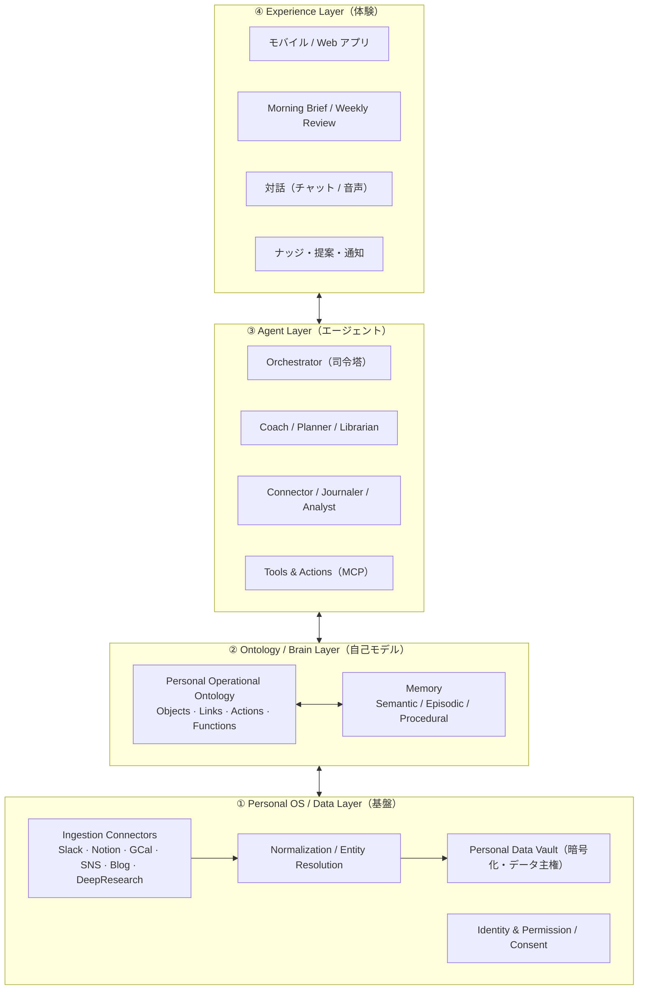

# Personal Brain OS（コードネーム: Kagami / 鏡）

> 個人版「Company Brain × Operational Ontology」。
> 自分のデータから **Personal Ontology（個人のデジタルツイン）** を構築し、その上で動く AI エージェントが、
> **AsIs（今の自分）から ToBe（なりたい自分）** に近づくためのバディ／コーチとして伴走する。

このリポジトリは、そのプロダクトと技術アーキテクチャの**仕様のたたき台**を管理する。

---

## コンセプトを一言で

組織向けに開発している「組織OSの上で動くAIエージェント（Company Brain × Operational Ontology）」の考え方を、
**個人（Personal）** に写像したもの。

| 組織版（既存プロジェクト） | 個人版（本プロジェクト） |
| --- | --- |
| Company Brain（組織の頭脳） | **Personal Brain**（個人の頭脳・自己モデル） |
| Operational Ontology（業務オントロジー） | **Personal Operational Ontology**（自己オントロジー） |
| 組織OS | **Personal OS**（データ主権・取り込み・権限） |
| 業務を回すAIエージェント | **Digital Twin エージェント**（伴走コーチ／バディ） |
| KPI / 業務目標の達成 | **AsIs → ToBe**（なりたい自分への接近） |

Palantir 的な Operational Ontology の肝は「**静的な知識グラフではなく、Objects / Links に加えて Actions（書き戻し）と Functions（計算ロジック）を持ち、意思決定と行動に接続された運用レイヤーである**」こと。
本プロダクトでは、この「行動に接続されたオントロジー」を個人に適用し、**自己理解 → 行動 → 学習** のループを回す。

---

## ドキュメント

| ファイル | 内容 |
| --- | --- |
| [`docs/01_product_spec.md`](docs/01_product_spec.md) | プロダクト仕様（ビジョン／ペルソナ／ユーザー体験／機能） |
| [`docs/02_architecture.md`](docs/02_architecture.md) | 技術アーキテクチャ（レイヤ構成／データ取り込み／エージェント／メモリ／技術選定） |
| [`docs/03_ontology_schema.md`](docs/03_ontology_schema.md) | Personal Ontology のスキーマ（Objects / Links / Actions / Functions） |
| [`docs/04_roadmap.md`](docs/04_roadmap.md) | フェーズ別ロードマップと MVP スコープ |
| [`docs/05_pm_review.md`](docs/05_pm_review.md) | VC / PM 視点の診断・ブラッシュアップ（killshot・ウェッジ・動機設計） |

---

## 4 レイヤ・アーキテクチャ（全体像）



---

## 中核となる「AsIs → ToBe ループ」

```
Sense（取り込み） → Model（自己モデル更新・AsIs算出）
      → Reflect/Plan（ToBeとのGap分析・介入立案）
        → Act/Propose（予定化・ナッジ・推薦・接続・問いかけ）
          → Learn（フィードバック・確信度と手続き記憶の更新）→ …繰り返し
```

エージェントは単なる「思い出し（recall）」ではなく、**構造化された自己モデル**を持ち、
**Gap を埋める行動を目標志向で提案・実行**する点が既存プロダクト（ライフログ／メモ系AI）との差別化。

---

## ステータス

- [x] コンセプト定義
- [x] 仕様のたたき台（本リポジトリ）
- [ ] MVP スコープ確定
- [ ] プロトタイプ実装

> 本ドキュメントは議論のたたき台。ここから壁打ちして精緻化する前提。
