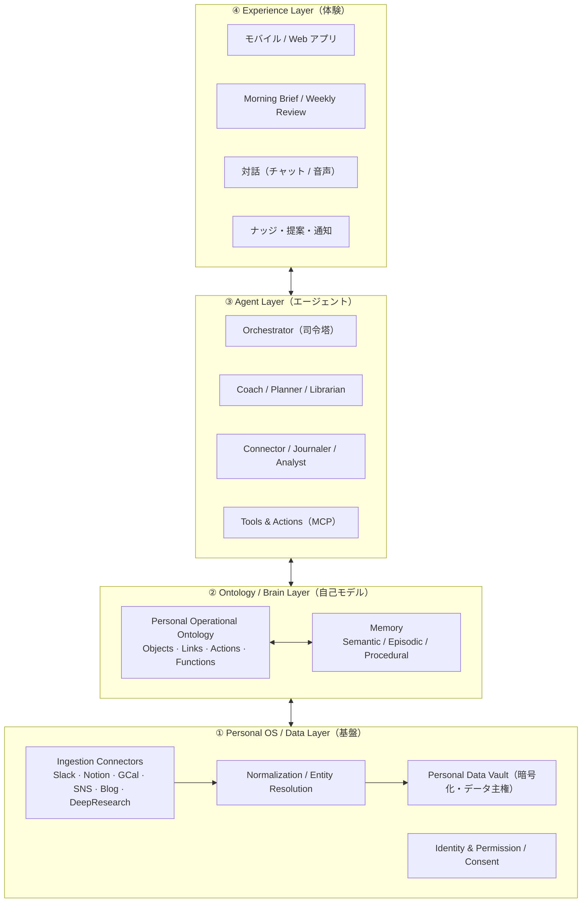

# Personal Brain OS（コードネーム: Kagami / 鏡）

> 個人版「Company Brain × Operational Ontology」。
> 自分のデータから **Personal Ontology（個人のデジタルツイン）** を構築し、その上で動く AI エージェントが、
> **AsIs（今の自分）から ToBe（なりたい自分）** に近づくためのバディ／コーチとして伴走する。

このリポジトリは、そのプロダクトと技術アーキテクチャの**仕様のたたき台**と、**MVP の歩くスケルトン（実コード）**を管理する。

## 現在の焦点（確定した方向性）

- **ウェッジ（最初の1セグメント）**: **ソロ起業家 / インディーハッカー**。
  ToBe（例:「v1 をローンチ」「初収益」）が具体・測定可能で、孤独ゆえに伴走価値が高く、データがデジタルに揃い、Founder-Market Fit がオーナー自身に近い。
- **勝ち筋の核**: 賢い自己モデルではなく、**やる気が切れた木曜の夜に開かれる「動機を内製する仕組み」**（→ [`docs/06`](docs/06_motivation_engine.md)）。
- **技術方針（確定）**: ローカルファースト / Postgres 中心（必要に応じ pgGraph・AGE）/ 組織版とは共通化しない。

---

## コンセプトを一言で

組織向けに開発している「組織OSの上で動くAIエージェント（Company Brain × Operational Ontology）」の考え方を、
**個人（Personal）** に写像したもの。

| 組織版（既存プロジェクト） | 個人版（本プロジェクト） |
| --- | --- |
| Company Brain（組織の頭脳） | **Personal Brain**（個人の頭脳・自己モデル） |
| Operational Ontology（業務オントロジー） | **Personal Operational Ontology**（自己オントロジー） |
| 組織OS | **Personal OS**（データ主権・取り込み・権限） |
| 業務を回すAIエージェント | **Digital Twin エージェント**（伴走コーチ／バディ） |
| KPI / 業務目標の達成 | **AsIs → ToBe**（なりたい自分への接近） |

Palantir 的な Operational Ontology の肝は「**静的な知識グラフではなく、Objects / Links に加えて Actions（書き戻し）と Functions（計算ロジック）を持ち、意思決定と行動に接続された運用レイヤーである**」こと。
本プロダクトでは、この「行動に接続されたオントロジー」を個人に適用し、**自己理解 → 行動 → 学習** のループを回す。

---

## ドキュメント

| ファイル | 内容 |
| --- | --- |
| [`docs/01_product_spec.md`](docs/01_product_spec.md) | プロダクト仕様（ビジョン／ペルソナ／ユーザー体験／機能） |
| [`docs/02_architecture.md`](docs/02_architecture.md) | 技術アーキテクチャ（レイヤ構成／データ取り込み／エージェント／メモリ／技術選定） |
| [`docs/03_ontology_schema.md`](docs/03_ontology_schema.md) | Personal Ontology のスキーマ（Objects / Links / Actions / Functions） |
| [`docs/04_roadmap.md`](docs/04_roadmap.md) | フェーズ別ロードマップと MVP スコープ |
| [`docs/05_pm_review.md`](docs/05_pm_review.md) | VC / PM 視点の診断・ブラッシュアップ（killshot・ウェッジ・動機設計） |
| [`docs/07_claude_processing_architecture.md`](docs/07_claude_processing_architecture.md) | Claude 内部処理の解剖図（Memory × Skills × 複数 MCP から出力までのハーネス／モデルの役割分解） |

---

## 4 レイヤ・アーキテクチャ（全体像）



---

## 中核となる「AsIs → ToBe ループ」

```
Sense（取り込み） → Model（自己モデル更新・AsIs算出）
      → Reflect/Plan（ToBeとのGap分析・介入立案）
        → Act/Propose（予定化・ナッジ・推薦・接続・問いかけ）
          → Learn（フィードバック・確信度と手続き記憶の更新）→ …繰り返し
```

エージェントは単なる「思い出し（recall）」ではなく、**構造化された自己モデル**を持ち、
**Gap を埋める行動を目標志向で提案・実行**する点が既存プロダクト（ライフログ／メモ系AI）との差別化。

---

## MVP 歩くスケルトン（実際に動く）

`取り込み → 自己モデル → AsIs 算出 → 介入(提案) → 伴走(Brief)` の最小一周を、
**外部サービス不要・オフラインで**動かせる（Node 22 の型ストリッピングを使用。依存インストールも不要）。

```bash
npm run demo     # フル一周（Interview → Ontology 構築 → Morning Brief → 動機ステートマシンのデモ）
npm run brief    # 保存済みの自己モデルからブリーフを再生成
npm run reset    # データ初期化
# ANTHROPIC_API_KEY を設定すると、事実抽出・言い換えを Claude(実LLM)が担当（任意）
```

### コード構成（概念 → 実装の対応）

| パス | 役割 | 対応ドキュメント |
| --- | --- | --- |
| `src/ontology/types.ts` | Objects / Links / Actions / Functions / Motivation の型 | docs/03 |
| `src/core/store.ts` | `OntologyStore` 抽象 + ローカル JSON 永続の `InMemoryStore`（本番は Postgres/AGE に差し替え） | docs/02 |
| `src/core/functions.ts` | `gapScore` / `momentum` / `driftRisk` / `burnoutSignal` / **`motivationState`** / `nextBestActions` | docs/03・06 |
| `src/core/loop.ts` | Sense→Model→Plan→Act→Learn の配線 | docs/02 §3.3 |
| `src/agents/interviewer.ts` | 5問オンボーディング → 事実を confidence+lineage で書き込み | docs/05 §3 |
| `src/agents/coach.ts` | Motivation State に応じ**姿勢を変えて** Morning Brief を生成 | docs/06 §4 |
| `src/agents/llm.ts` | LLM ポート（オフライン Stub / Claude アダプタ） | docs/02 §3.2 |
| `db/schema.sql` | 本番ターゲットの Postgres + pgvector + AGE スキーマ | docs/02 |

> 差別化の核（動機の内製）は `functions.ts` の `motivationState()` と `coach.ts` の姿勢別テンプレに実装。
> `demo` の【4】で「同じ人・違う状況 → 姿勢が変わる」様子を確認できる。

## ステータス

- [x] コンセプト定義
- [x] 仕様のたたき台（本リポジトリ）
- [x] ウェッジ確定（インディーハッカー）／動機エンジン設計
- [x] MVP 歩くスケルトン（動作確認済み）
- [ ] Wizard-of-Oz 4週間検証（次の一手）
- [ ] コネクタ実装（GitHub / カレンダー）と Postgres 移行

> 本ドキュメントは議論のたたき台。ここから壁打ちして精緻化する前提。
