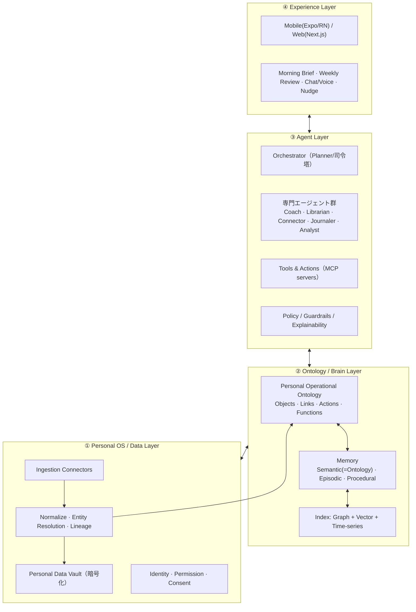

# 02. 技術アーキテクチャ（Architecture）

組織版の「Company Brain × Operational Ontology」を個人に写像した、4 レイヤ構成。
中核は **② Ontology / Brain Layer**（行動に接続された自己モデル）と **③ Agent Layer**（伴走ループ）。



---

## ① Personal OS / Data Layer（基盤：データ主権と取り込み）

### 1.1 Ingestion Connectors（取り込み）
- **接続対象（初期）**: Google カレンダー、Notion、Slack、SNS（X 等）、ブログ / プロフィールサイト（URL クロール）、Deep Research 成果物（PDF / Markdown / URL）。
- **方式**: OAuth 2.0 + 増分同期（webhook が有れば push、無ければ polling）。ファイル / URL は手動アップロード + クロール。
- **実装選択肢**:
  - コネクタ基盤: [Nango](https://www.nango.dev/) / Paragon / Airbyte（OSS）等を活用し、自前実装を最小化。
  - Web クロール: Firecrawl / Playwright（本環境に Chromium 同梱）。
- 各ソースは **Raw Store**（object storage）に原本を保持し、後段で正規化。

### 1.2 Normalize · Entity Resolution · Lineage
- 各ソースの生データを **Canonical Event / Document / Entity** の共通スキーマに正規化。
- **Entity Resolution**: 同一人物・同一プロジェクトの名寄せ（Slack の @user と連絡先を統合、等）。
- **Lineage（データ系譜）**: すべての正規化事実・オントロジー事実に「どのソースの・いつの・どのレコード由来か」を保持（Palantir 的 lineage）。説明可能性と削除・再計算の基盤。

### 1.3 Personal Data Vault（データ主権）
- ユーザーごとに論理分離した保管領域。**保存時暗号化**、コネクタトークンは秘密管理（KMS / Vault）。
- **設計原則**:
  - ユーザーが所有者。**モデル学習に使わない**（no-training）。
  - いつでも **エクスポート / 完全削除（right to be forgotten）**。
  - 削除は lineage をたどってオントロジー側の派生事実も連鎖削除・再計算。
- **将来オプション**: ローカルファースト / セルフホスト可能な Vault（機微データは端末側 or ユーザー管理環境に置く）。

### 1.4 Identity · Permission · Consent
- 認証: Clerk / Auth0 / WorkOS 等。
- **同意（Consent）はコネクタ単位・データ種別単位**で管理。何を取り込み、何にエージェントがアクセスして良いかを細分化。

---

## ② Ontology / Brain Layer（中核：自己モデル）

Palantir の Operational Ontology を個人に適用。**「静的な知識グラフ」ではなく、Objects / Links に加えて Actions（書き戻し）と Functions（計算）を備え、行動と意思決定に接続された運用層**とする。
詳細スキーマは [`03_ontology_schema.md`](03_ontology_schema.md)。

### 2.1 オントロジーの 4 構成要素
- **Objects（名詞）**: Person(self) / Value / Goal / Theme / Skill / Habit / Project / Task / Relationship / Resource / Reflection / State など。
- **Links（関係）**: `Habit —contributes_to→ Goal`, `Resource —develops→ Skill`, `Goal —supports→ Theme` など。
- **Actions（動詞・書き戻し）**: カレンダーに集中ブロックを入れる / 習慣プランを更新 / リソースをキュー投入 / 紹介を提案 / 振り返りを記録。**オントロジーが実世界へ作用する層**。
- **Functions（計算）**: `gap_score(goal)`, `momentum(habit)`, `alignment_score(today)`, `drift_risk()`, `burnout_signal()` など、AsIs を数値化する派生ロジック。

### 2.2 Memory アーキテクチャ（認知アーキテクチャに対応）
- **Semantic Memory（意味記憶）= Ontology 本体**。安定した「自分についての事実」。
- **Episodic Memory（エピソード記憶）**: 出来事・対話・ログの時系列。ベクトル + タイムライン。
- **Procedural Memory（手続き記憶）**: 「このユーザーはどう働きたいか / どう励ますと動くか」等、エージェントの振る舞いプレイブック。フィードバックで更新。
- **忘却 / 更新**: 確信度の減衰、矛盾検出時の統合（新しい事実で上書き or 併存 + 出典比較）。

### 2.3 ストレージ / インデックス
- **Graph**: property graph（Neo4j / Postgres + Apache AGE / FalkorDB）でオブジェクトとリンクを保持。
- **Vector**: pgvector / Qdrant / LanceDB でエピソード記憶と文書の意味検索。
- **Relational + Time-series**: 状態・習慣ログ・スコアの推移（Postgres / Timescale）。
- **推奨初期構成**: **Postgres 一本（+ pgvector + AGE）に寄せ**、スケール時に専用 Graph/Vector DB へ分離。運用をシンプルに。

> 設計判断: 「純粋な万能グラフDB」より、**オントロジーをアプリ層の抽象（Object/Link/Action/Function の型定義）として持ち、物理ストアは Postgres 中心**にする方が、初期の開発速度・整合性・移行性のバランスが良い。

---

## ③ Agent Layer（伴走：AsIs→ToBe ループの実行者）

### 3.1 マルチエージェント構成（司令塔 + 専門家）
- **Orchestrator（司令塔 / Planner）**: 状況を評価し、どの専門エージェント・どのツールを・どの順で使うか計画。
- **専門エージェント**:
  - **Coach**: 目標・動機づけ・コーチング対話（GROW / 自己決定理論）。
  - **Planner**: 学習計画・タスク分解・スケジューリング。
  - **Librarian / Curator**: 本・記事・講座などリソースの探索と推薦。
  - **Connector**: 関係性グラフから人・機会をマッチングし「つなぐ」。
  - **Journaler**: 振り返り・ジャーナリングの促しと要約、洞察抽出。
  - **Analyst**: AsIs 算出・Gap 分析・ドリフト/バーンアウト検知。
  - **Interviewer**: 能動学習でオントロジーの空白を埋める質問生成。
- 各エージェントは **スコープされたオントロジー・ビューとツール**のみを持つ（最小権限）。

### 3.2 Tools & Actions（MCP）
- Actions は **MCP（Model Context Protocol）サーバ**として実装し、モデルから安全に呼び出す。
  - 例: `calendar.create_focus_block`, `habit.update_plan`, `resource.enqueue`, `ontology.write_fact`, `notify.nudge`。
- **書き戻し系 Action はガードレール必須**（下記 3.4）。
- モデル: **Claude を基軸**。計画・コーチング対話は上位モデル（Opus 系）、要約・分類・軽量処理は Haiku 系にルーティングしコスト最適化。

### 3.3 中核ループ（Sense → Model → Reflect/Plan → Act → Learn）
```
1. Sense   : 新規シグナル取り込み → 正規化 → オントロジー更新（差分）
2. Model   : Functions 再計算 → AsIs 状態・各 Gap を更新
3. Reflect : Gap × Value × Theme を突き合わせ、介入候補を生成
             介入スコア = 期待Gap縮小 × 実現可能性 × 価値観との整合 × 現在のキャパ/エネルギー
4. Act     : 予定化 / ナッジ / 推薦 / 接続 / 問いかけ（承認フロー経由）
5. Learn   : 受容/拒否・結果を記録 → 確信度と手続き記憶を更新
```
- **起動トリガ**: 時間（朝・週次）、イベント（新データ到着・カレンダー変化）、ユーザー起点（相談）。

### 3.4 Policy / Guardrails / Explainability
- **人間承認（Human-in-the-loop）**: 外部に作用する Action（メッセージ送信・他者への紹介など）は原則ユーザー承認必須。
- **説明可能性**: すべての提案は「根拠となったオントロジー事実 + 出典」を提示できる。
- **安全**: 健康・メンタル領域は慎重に。危機兆候検知時は助言せず適切な専門リソースへ誘導するフェイルセーフ。
- **プロンプトインジェクション対策**: 取り込んだ外部テキスト（ブログ・SNS・PDF）は「データ」として扱い、指示として実行しない境界を明確化。

---

## ④ Experience Layer（体験）

- **アプリ**: モバイルファースト（React Native / Expo）＋ Web（Next.js）。日々の伴走はモバイル、深い編集・可視化は Web。
- **主要面**: Morning Brief、Weekly Review、チャット/音声、AsIs ダッシュボード、自己モデルの閲覧・修正、ゴール管理。
- **通知**: プッシュ通知でナッジ。頻度はユーザー設定 + 手続き記憶で最適化（うるさくしない）。

---

## 5. 技術スタック（推奨・たたき台）

| 領域 | 推奨 | 備考 |
| --- | --- | --- |
| 言語 / BE | TypeScript（Node）or Python | エージェント資産の多さなら Python、フルスタック一貫なら TS |
| エージェント基盤 | LangGraph / 自前オーケストレーション + MCP | 決定的な制御フロー（ループ・分岐）を重視 |
| LLM | Claude（Opus=計画/対話, Haiku=軽量処理） | 機微データはルーティングで保護 |
| DB | Postgres + pgvector + AGE(graph) | 初期は一本化、後で分離 |
| ベクトル | pgvector → Qdrant/LanceDB | スケール時 |
| コネクタ | Nango / Airbyte / Firecrawl | 自前実装を最小化 |
| 認証 | Clerk / WorkOS | |
| フロント | Next.js（Web）/ Expo（モバイル） | |
| インフラ | Vault/KMS, オブジェクトストレージ, キュー(SQS/Redis) | 同期・非同期処理の分離 |

---

## 6. 主要な技術的論点（要議論）

1. **オントロジーの物理表現**: 汎用グラフDB vs アプリ層抽象 + Postgres。→ 初期は後者を推奨。
2. **プライバシーの徹底度**: クラウド中心か、ローカルファースト / セルフホスト Vault まで踏み込むか。ターゲットの信頼要件次第。
3. **コールドスタート戦略**: Interview 主導でどこまで初期価値を出すか。
4. **AsIs の定量化**: スキル/価値観など曖昧な対象をどう数値化し、過信を避けるか（確信度と幅を持たせる）。
5. **組織版とのアーキテクチャ共通化**: オントロジーの型定義・Action(MCP)・エージェント基盤を組織版と共通コアにできるか（資産の再利用）。
