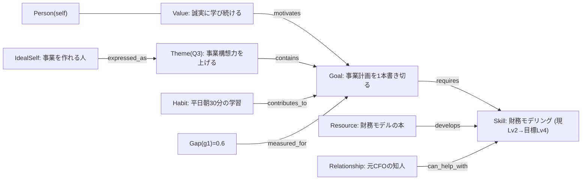

# 03. Personal Operational Ontology スキーマ

自己モデルを構成する **Objects / Links / Actions / Functions** の定義（たたき台）。
Palantir 的に、名詞（Objects）と関係（Links）だけでなく、**動詞（Actions＝実世界への書き戻し）** と **計算（Functions）** を含めることで「行動に接続された運用オントロジー」にする。

すべての Object / 事実（fact）は共通メタを持つ:
```
_meta:
  id:          uuid
  confidence:  0.0–1.0        # 確信度（対話・データで更新）
  sources:     [lineageRef]   # 出典（どのソース由来か）
  created_at / updated_at
  valid_from / valid_to        # 時間有効性（過去の自分も保持）
  status:      active | superseded | forgotten
```

---

## 1. Objects（オブジェクト）

### 自己の中核
| Object | 説明 | 主なプロパティ |
| --- | --- | --- |
| **Person(self)** | ユーザー本人（唯一のセルフオブジェクト） | name, personas[], summary |
| **Persona** | 文脈ごとの自分の顔（仕事/家庭/創作など） | context, description |
| **Value / Principle** | 価値観・行動指針 | statement, priority, origin_story |
| **Interest / Topic** | 関心・テーマ領域 | label, intensity |
| **Trait / Tendency** | 性格傾向・思考癖 | label, evidence[] |

### 目標と方向性（ToBe 側）
| Object | 説明 | 主なプロパティ |
| --- | --- | --- |
| **IdealSelf（ありたい姿）** | なりたい自分の像 | narrative, horizon |
| **Theme** | 期間テーマ（例: 今四半期のテーマ） | title, period, why |
| **Goal** | 目標 | title, type(learning/career/health/…), target_state, deadline |
| **Objective / KeyResult** | 目標の分解（OKR ライク） | metric, target, current |
| **Milestone** | 中間到達点 | title, due, done |

### 現在地と実行（AsIs / 行動側）
| Object | 説明 | 主なプロパティ |
| --- | --- | --- |
| **Skill / Competency** | スキル | name, current_level, target_level, evidence[] |
| **Habit / Routine** | 習慣 | name, cue, cadence, streak |
| **Project / Initiative** | 進行中の取り組み | title, status |
| **Task / Action-item** | タスク | title, due, status, effort |
| **Commitment** | 約束・宣言 | statement, to_whom, due |
| **State / Signal** | 状態（気分・エネルギー・睡眠等） | kind, value, at |

### 記録・外部リソース
| Object | 説明 | 主なプロパティ |
| --- | --- | --- |
| **Reflection / Journal** | 振り返り・日記 | text, mood, at |
| **Insight** | 抽出された洞察 | statement, derived_from[] |
| **Event** | 予定・会議（カレンダー由来） | title, start, end, attendees[] |
| **Relationship / Contact** | 関係する人物 | name, role, closeness, channels[] |
| **Resource** | 本・記事・講座・人・機会など推薦候補 | kind, title, url, topic |
| **Gap** | AsIs と ToBe の差（Function 由来の派生オブジェクト） | goal_ref, dimensions, score |

---

## 2. Links（関係）

方向性を持つ関係。オントロジーの推論・介入立案はこのリンクをたどる。

```
IdealSelf      —expressed_as→     Theme
Theme          —contains→         Goal
Goal           —decomposes_into→  Objective / KeyResult / Milestone
Goal           —requires→         Skill
Habit          —contributes_to→   Goal
Task           —advances→         Objective
Resource       —develops→         Skill
Resource       —about→            Topic
Relationship   —mentors / inspires→ Person(self)
Relationship   —can_help_with→    Goal / Skill
Reflection     —about→            Goal / Project / Event
Insight        —derived_from→     Reflection / Event / Document
Value          —motivates→        Goal
State          —affects→          Habit / Task（実行可能性）
Event          —relates_to→       Project / Goal
Gap            —measured_for→      Goal / Skill
```

---

## 3. Actions（書き戻し＝実世界への作用）

オントロジーが「読む」だけでなく「動かす」ための操作。**MCP ツールとして実装**し、外部作用はユーザー承認フローを通す。

| Action | 概要 | 承認 |
| --- | --- | --- |
| `calendar.create_focus_block` | 目標/習慣のための集中時間を予定化 | 自動 or 確認 |
| `habit.upsert_plan` | 習慣プランの新規/更新（cue・頻度） | 確認 |
| `task.create / reschedule` | タスク生成・再計画 | 自動 |
| `resource.enqueue` | 本/記事/講座をリーディングキューへ | 自動 |
| `intro.suggest` | 人への紹介・相談を提案 | **必須（対人）** |
| `nudge.send` | ナッジ/リマインド送信 | 設定に従う |
| `reflection.log` | 振り返りを記録 | 自動 |
| `ontology.write_fact` | 対話で得た事実をオントロジーへ反映 | 自動（確信度付き） |
| `goal.replan` | ドリフト検知時に計画を組み直す | 確認 |

---

## 4. Functions（計算＝AsIs の定量化と検知）

オントロジー上の派生ロジック。AsIs を数値化し、介入の起点になる。

| Function | 返すもの | 用途 |
| --- | --- | --- |
| `gap_score(goal)` | 0–1 の Gap（AsIs と target_state の差） | 優先度づけ・可視化 |
| `skill_level(skill)` | 現在のスキル水準（evidence から推定・幅付き） | AsIs ダッシュボード |
| `momentum(habit\|goal)` | 勢い / streak / 直近の実行率 | 継続支援 |
| `alignment_score(day\|week)` | 今日/今週の行動が価値観・目標と整合しているか | 振り返り |
| `drift_risk(goal)` | 目標から逸れつつある度合い | 早期介入 |
| `burnout_signal()` | 過密・低エネルギー・ネガ気分の複合シグナル | フェイルセーフ |
| `capacity(now)` | 今の可処分時間/エネルギー | 介入の実現可能性判定 |
| `next_best_action()` | 介入候補ランキングの最上位 | Morning Brief の「今日の一手」 |

`next_best_action` のスコアリング例:
```
score(action) =
    w1 * expected_gap_reduction        # どれだけ ToBe に近づくか
  + w2 * feasibility(capacity, state)  # 今の自分に実行可能か
  + w3 * value_alignment               # 価値観・テーマと合っているか
  - w4 * fatigue / over_scheduling     # 詰め込みすぎ回避
```

---

## 5. 具体例（あるユーザーのミニ・オントロジー）



エージェントの動き（このオントロジーに対して）:
- `Analyst` が `gap_score(g1)=0.6`、`skill_level(s1)=Lv2` を算出。
- `next_best_action()` が「平日朝の学習ブロックを来週分予約」を最上位に。
- `Librarian` が `r1`（財務モデルの本）を今週のリソースに提案。
- `Connector` が「元CFOの知人に 30 分相談してみては?」を **承認前提**で提案。
- `Coach` が Weekly Review で `alignment_score` を振り返り、価値観 v1 と結びつけて動機づけ。
