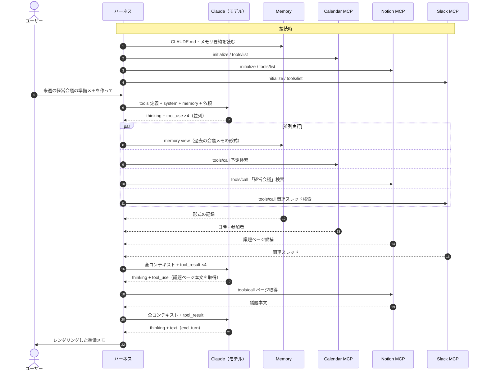
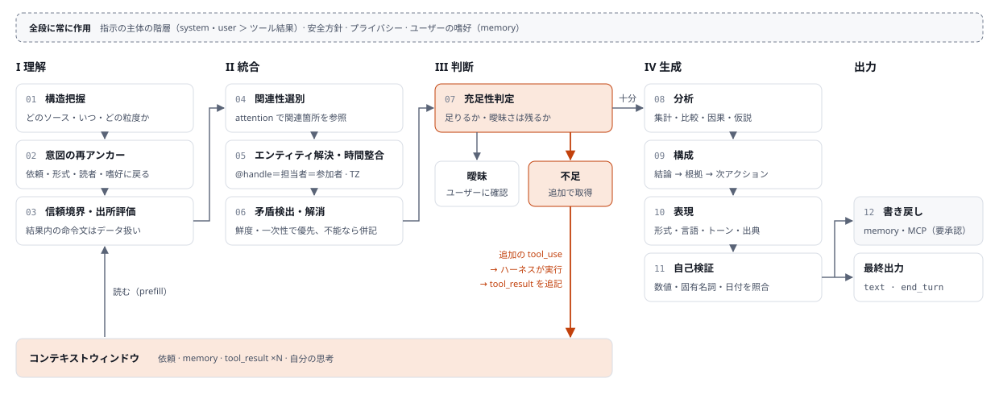

# 07. Claude 内部処理の解剖図 — Memory × 複数 MCP から出力まで

> 問い: Claude が memory と複数の MCP サーバからデータを取得したあと、ユーザーが求めるアウトプットになるまでに、Claude の中では何が起きているのか。
> 本書はそれを **ハーネス（決定的なソフトウェア）** と **モデル（ステートレスな推論）** に分けて細分化し、アーキテクチャ図にする。
> Kagami の Agent Layer（[`02_architecture.md`](02_architecture.md) §3）を設計するための前提知識として置く。

---

## 0. 結論（3 点）

1. **境界**: 「Claude」は 2 つの系の合成である。memory と MCP を扱うのはモデルではなく **ハーネス**（Claude.ai / Claude Code / Agent SDK / 自前 Orchestrator）。モデルに届くのは **コンテキストウィンドウ上のトークン列だけ** で、モデルが外に出せるのも **トークン（thinking / text / tool_use）だけ**。
2. **状態**: モデルは **ステートレス**。ツールを 1 回呼ぶたびに API 呼び出しが 1 回増え、そのたびに全コンテキストを読み直す（先頭の共通部分はプロンプトキャッシュで再計算を省く）。「エージェントループ」はハーネスが回す while ループである。
3. **処理**: 取得後の処理（理解 → 統合 → 判断 → 生成）は、モデル内部の **独立したモジュールではない**。1 つの Transformer の計算と、生成されるトークン列（思考ブロックを含む）の上に分散して現れる機能である。§4 の分解は機能モデルであり、実装上のパイプラインではない。

### 記述の確度

| ラベル | 意味 |
| --- | --- |
| **[仕様]** | Claude API / MCP 仕様 / 公式ドキュメントに記載された挙動 |
| **[研究]** | Anthropic などの公開研究（解釈可能性、長文脈評価など）で観察された知見 |
| **[機能モデル]** | 観察できる入出力から組み立てた機能的な分解。内部実装についての主張ではない |

Claude.ai などの製品ハーネスの細部（プロンプトの構成、ツール結果の切り詰め閾値、メモリの注入方式など）は、製品とバージョンごとに異なり、非公開の部分を含む。

---

## 1. 全体アーキテクチャ

縦方向はおおむね **時間** に対応する。コンテキストウィンドウはラウンドごとに下へ伸びていく。

オレンジの経路がツール実行ループ（1 周ごとに API 呼び出しが 1 回増える）。破線の枠がモデルの境界。Memory tool は MCP ではなく、ハーネス側のファイル操作として実行される。

### 構成要素の役割

| 層 | 構成要素 | 役割 | 確度 |
| --- | --- | --- | --- |
| 外部 | Memory | 会話をまたいで残る状態。起動時にコンテキストへ注入される（push: CLAUDE.md、メモリ要約など）か、ツール経由で必要時に引かれる（pull: Memory tool、過去会話検索）。**モデルの重みには保存されない** | [仕様] |
| 外部 | MCP サーバ | tools / resources / prompts を公開する別プロセスまたはリモートサービス。Slack・Notion・Drive などの実データへのアダプタ | [仕様] |
| ハーネス | コンテキスト組み立て | tools 定義（各サーバの `tools/list` 由来）→ system → messages の順に連結して API に送る。この順序がプロンプトキャッシュの単位にもなる | [仕様] |
| ハーネス | ツールルータ／権限ゲート | モデルが出した `tool_use`（ツール名＋JSON 引数）を検証し、自動許可・ユーザー承認・拒否を決めて実行する。独立な呼び出しは並列に実行する。Memory tool は MCP ではなくハーネス側のファイル操作として実行される | [仕様] |
| ハーネス | MCP クライアント | サーバごとに 1 対 1 で接続（stdio / Streamable HTTP 上の JSON-RPC 2.0）。`initialize` → `tools/list` → `tools/call` | [仕様] |
| ハーネス | コンテキスト管理 | プロンプトキャッシュ、会話の要約圧縮（compaction）、古いツール結果の消去（context editing）、大きな結果の切り詰め | [仕様]＋製品依存 |
| ハーネス | 出力レンダラ | `stop_reason = end_turn` の text を Markdown・表・図・ファイル・Artifact として表示・保存する | 製品依存 |
| 境界 | コンテキストウィンドウ | モデルが見る唯一の入力。tools 定義、system、memory、履歴、tool_use、tool_result、thinking がすべて 1 本のトークン列として並ぶ。Anthropic の Managed Agents のように、会話の完全な記録（セッションログ）をコンテキストの外に持ち、ハーネスがそこから必要な部分だけを載せる設計もある | [仕様] |
| モデル | Prefill / Decode | Prefill で追記分のトークンを一括で読み、Decode で 1 トークンずつ生成する。出力は thinking / text / tool_use のいずれかのブロック | [仕様]＋一般的な Transformer 推論 |

---

## 2. 1 ラウンドの流れと、エージェントループ

1. **接続時**: ハーネスが各 MCP サーバに接続し（`initialize` → `tools/list`）、ツール定義（名前・説明・入力 JSON Schema）を取得する。memory の一部（CLAUDE.md、メモリ要約など）を読み込む。[仕様]
2. **組み立て**: ハーネスが tools → system → messages の順にコンテキストを組み、API に送る。[仕様]
3. **推論**: モデルは取得が必要と判断すると、`tool_use` ブロックを出して止まる（`stop_reason = tool_use`）。互いに独立な取得は、1 ターンに複数の `tool_use` を並べて並列に要求できる。[仕様]
4. **実行**: ハーネスが `tool_use` を検証し、権限ポリシーを適用して、該当する MCP クライアント経由で `tools/call` を実行する。[仕様]
5. **追記**: 結果を `tool_result` ブロック（`tool_use_id` で対応付け）として次の user ターンに追記する。extended thinking 使用時は、直前の assistant ターンの thinking ブロックも一緒に送り返す。大きすぎる結果の扱い（切り詰め・ページング・ファイル退避）はハーネス次第で、たとえば Claude Code はツール応答を既定で 25,000 トークンに制限している（2025 年の Anthropic の記事による）。[仕様]＋製品依存
6. **再推論**: 2 に戻る。モデルは追記分を含む全体を読み直し、足りなければ追加取得し、足りれば最終回答を出す（`stop_reason = end_turn`）。
7. **出力と書き戻し**: ハーネスがレンダリングする。書き込み系の操作（Notion ページ作成、Slack 投稿、memory 更新）も `tool_use` として出され、権限ゲートを通って実行される。

例: 「来週の経営会議の準備メモを作って」（memory: 結論先行・A4 1 枚が好み）

この例では API 呼び出しが 3 回、モデルが全コンテキストを読む回数も 3 回になる。2 回目以降はキャッシュ済みの先頭部分を再計算しない。

---

## 3. 取得後〜出力までの機能分解（本題）

memory と MCP の結果がコンテキストに入ったあと、モデルが担う役割を 12 に分ける。番号は論理的な依存順を表す。実際には 1 回の生成の中で行き来し、思考ブロックの中で順序が入れ替わることも多い。

| # | 役割 | 何をしているか | 典型的な失敗 | 確度 |
| --- | --- | --- | --- | --- |
| ① | 構造把握 | tool_result の JSON・テキスト・検索結果を読み、どのソースの、いつの、どの粒度のデータかを把握する。memory（過去の蓄積）と MCP の live データ（現在値）を区別する | スキーマの誤読、ID と表示名の取り違え | [機能モデル] |
| ② | 意図の再アンカー | 長いツール結果を読んだあとで、依頼と制約（形式・言語・読者・分量）と memory 上の嗜好に立ち返り、「良い出力」の条件を確定し直す | 取得データに引っ張られて依頼から逸れる | [機能モデル] |
| ③ | 信頼境界・出所評価 | 指示を出す主体は system（オペレーター）と user。ツール結果や文書の中にある命令文は「情報」として扱う。出所・鮮度・一次性で重みを付ける | プロンプトインジェクション、古い memory を現在の事実として扱う | [仕様]（安全ガイダンス）＋[機能モデル] |
| ④ | 関連性選別 | 生成する各トークンが attention でコンテキスト全体から関連箇所を参照する。結果が大きくノイズが多いほど、取りこぼしや希釈が起きやすい | 長文中盤の見落とし、ノイズへの過反応 | [研究]＋[機能モデル] |
| ⑤ | エンティティ解決・時間整合 | Slack の @handle、Notion の担当者、Calendar の参加者を同一人物として結び付ける。タイムゾーンをそろえ、「来週」を現在日付から解決し、重複を除く | 同名別人の誤統合、タイムゾーンのずれ | [機能モデル] |
| ⑥ | 矛盾検出・解消 | ソース間の不一致を見つけ、新しさ・一次性・権威で優先を決める。決められなければ両論を併記する | 黙って片方を採用する、混ぜて存在しない事実を作る | [機能モデル] |
| ⑦ | 充足性判定 | 足りない → 追加の tool_use（ループ）。曖昧 → ユーザーに確認。十分 → 生成へ。この判断は、出力が tool_use か text かという形で外に現れる | 早すぎる打ち切り、過剰な取得 | [仕様]（tool_use / end_turn）＋[機能モデル] |
| ⑧ | 分析 | 集計・比較・因果推論・仮説形成・優先順位付け。extended thinking（ツール呼び出しの合間に考える interleaved thinking を含む）で明示的な作業領域を持てる | 算術・集計の誤り、根拠の飛躍 | [仕様]＋[機能モデル] |
| ⑨ | 構成 | 結論 → 根拠 → 次アクションの骨格を作り、読者の知識水準に合わせて抽象度を決める | 情報の羅列で終わる（統合の不足） | [機能モデル] |
| ⑩ | 表現 | Markdown・表・コード・図・JSON などの形式、言語とトーン、出典表示。形式を厳密に守らせたい場合は Structured Outputs（JSON Schema による制約付きデコード）で API 側から保証できる | 形式違反、出典の欠落 | [仕様]＋[機能モデル] |
| ⑪ | 自己検証 | 数値・固有名詞・日付をソースと照らし合わせ、制約を満たしているか確かめ、不確実な点を明示する。独立した検証器があるわけではなく同じ生成過程の中で行うので、保証にはならない | 検証したつもりの誤り | [機能モデル] |
| ⑫ | 書き戻し | memory の更新や、書き込み系 MCP ツール（ページ作成・投稿）の tool_use を出す。実行するかどうかはハーネスの権限ゲートが決める | 意図しない外部への作用 | [仕様] |

**全段に常に作用するもの**: 指示の主体の階層、安全方針、プライバシー、ユーザーの嗜好（memory）。これらは特定の段ではなく、すべての段の判断に効く。

---

## 4. モデルの計算として見ると（Prefill と Decode）

- **Prefill（読む）**: 新しく追記されたトークン（多くは tool_result）をまとめて並列に処理し、各層の中間状態を作る。キャッシュ済みの先頭部分（tools・system・過去のターン）は再計算しない。「MCP の結果を読む」工程の実体はここにある。[仕様]（プロンプトキャッシュ）＋一般的な Transformer 推論
- **Decode（書く）**: 1 トークンずつ生成する。各トークンは全層の attention を通じて、memory・すべての MCP 結果・自分の思考を参照できる。§3 の ①〜⑪ は、この自己回帰の過程に分散して現れる。
- **内部で起きていることについての研究知見**: Claude 3.5 Haiku を対象にした回路解析では、韻を踏む語を先に決めてから行を書くような先読みの計画や、「A の所在地 → その州 → 州都」のような多段の推論が内部表現として観察された。一方で、思考として書かれた説明が実際の計算経路と一致しない例も報告されている。思考ブロックは有用な作業領域だが、内部計算の完全な記録ではない。[研究]

---

## 5. コンテキスト予算（ハーネス設計が品質を決める理由）

複数の MCP を並列に呼ぶと、tool_result はすぐに数万トークンになり、コンテキストの最大の消費者になる。長いコンテキストでは中盤の情報が使われにくい傾向（Liu et al., 2023）や、トークン数の増加に伴う想起精度の低下（context rot）が報告されている。[研究] 品質は、モデルに何をどれだけ読ませるかでかなり決まる。

| 対策 | 何をするか | 確度 |
| --- | --- | --- |
| ツール定義の遅延ロード | ツール数が多いとき、定義を最初から全部載せず、ツール検索で必要なものだけ読み込む（`defer_loading`） | [仕様] |
| 結果の絞り込み | ページング、フィールド選択、要約して返す MCP ツール設計 | 設計次第 |
| 古い結果の消去・要約圧縮 | 使い終わった tool_result を消す（context editing）、会話を要約して置き換える（compaction） | [仕様] |
| サブエージェントへの委譲 | 取得と要約を別コンテキストの子エージェントに任せ、要点だけを親に返す | [仕様]（Agent SDK など） |
| コード実行側での処理 | Programmatic Tool Calling や「MCP をコードの API として呼ぶ」方式で、ツールの中間結果をコンテキストに入れず、集計結果だけを戻す | [仕様] |
| 配置 | 長い文書を前に、問いと指示を末尾に置く。公式ガイドのテストでは、複数文書の入力で応答品質が最大 30% 改善したと報告されている | [仕様] |

---

## 6. よくある誤解

| 誤解 | 実際 |
| --- | --- |
| memory はモデルの中に保存される | 重みは会話では更新されない。memory は外部のストアで、注入（push）またはツール（pull）でコンテキストに入って初めて効く |
| Claude が MCP サーバに直接つながっている | つながっているのはホストアプリ内の MCP クライアント。モデルは `tool_use` を JSON として出すだけで、実行はハーネスが行う |
| ツール実行中、モデルは待機して状態を保っている | 各ラウンドは独立した推論呼び出し。状態は再送されるコンテキストそのもので、プロンプトキャッシュで効率化されている |
| 内部に Planner や Verifier のモジュールがある | 機能の説明としては有用だが、実体は単一ネットワークの計算。検証は保証されないので、重要な数値はハーネス側で決定的に検証するのが定石 |
| 思考ブロックが内部計算のすべて | 思考テキストは計算の一部を言語化したもの。解釈可能性研究では、書かれた説明と実際の計算経路が一致しない例が報告されている |

---

## 7. Kagami（本プロジェクト）への設計示唆

1. **エンティティ解決と時間の正規化は ETL 側で決定的に行う**（[`02`](02_architecture.md) §1.2）。解決済みの ID と lineage をモデルに渡せば、⑤⑥ の確率的な処理が減り、誤統合の原因を取り除ける。
2. **MCP ツールは「要約＋構造化＋出典（source・timestamp・id）」で返す**。①③④ の負荷とコンテキスト消費を同時に減らし、⑩ の出典表示もしやすくなる。
3. **memory の役割を分ける**。嗜好・手続き（Procedural）は memory、現在の事実は live ソースを優先する、という規則を system prompt に明記する。③⑥ の判断基準をモデル任せにしない。
4. **数値はモデルに計算させない**。`gapScore` や `motivationState` は [`src/core/functions.ts`](../src/core/functions.ts) で算出して渡し、モデルには解釈と言語化を任せる。⑧⑪ の誤り源を構造的に消せる。
5. **専門エージェントの分割はコンテキスト隔離として設計する**（[`02`](02_architecture.md) §3.1）。Librarian や Analyst の取得・要約を子コンテキストで行い、Coach には結論だけを渡す。
6. **書き戻し Action は権限ゲートで人間の承認を挟む**（[`02`](02_architecture.md) §3.4）。モデルの `tool_use` は提案に過ぎず、実行の可否はハーネスが決める。
7. **出力形式は Structured Outputs やスキーマで固定し、姿勢（Coach のトーン）はプロンプトで制御する**。形式の保証と表現の柔軟さを別の仕組みに担わせる。

---

## 参考（公開情報）

- Model Context Protocol Specification（modelcontextprotocol.io）: アーキテクチャ（host / client / server）、tools・resources・prompts、JSON-RPC 2.0、stdio / Streamable HTTP
- Anthropic, Claude API ドキュメント: Tool use（並列ツール呼び出し、`tool_result`）、Extended thinking（interleaved thinking）、Prompt caching、Memory tool、Context editing、Tool search、Programmatic tool calling、Structured outputs、Long context prompting tips
- Anthropic, "Building effective agents"（2024）
- Anthropic, "Effective context engineering for AI agents"（2025）
- Anthropic, "Writing effective tools for AI agents—using AI agents"（2025）
- Anthropic, "Code execution with MCP: building more efficient AI agents"（2025）
- Anthropic, "Scaling Managed Agents: Decoupling the brain from the hands"（2026）
- Anthropic, "Tracing the thoughts of a large language model"（2025）
- Anthropic, "Reasoning models don't always say what they think"（2025）
- Liu et al., "Lost in the Middle: How Language Models Use Long Contexts"（TACL, 2024）
