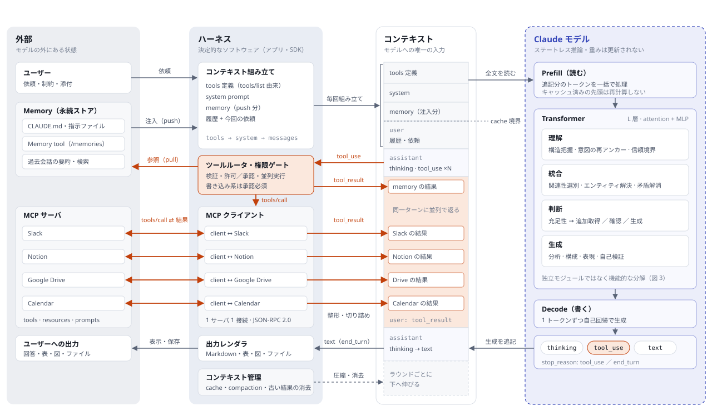
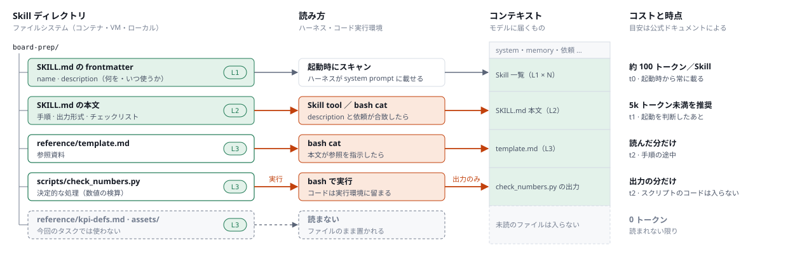
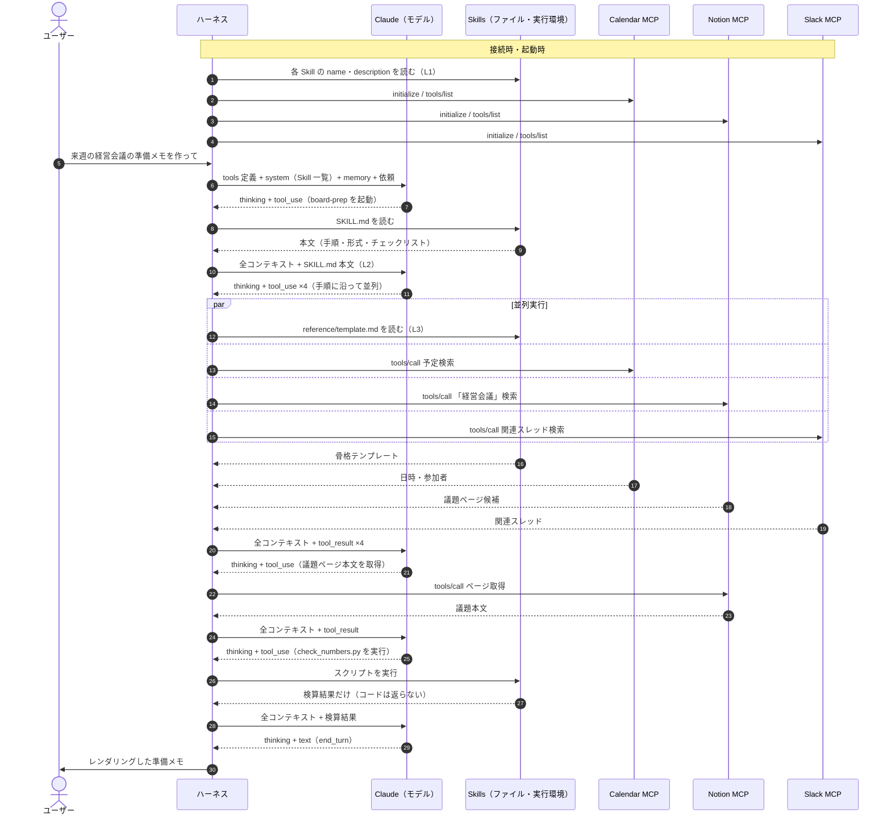
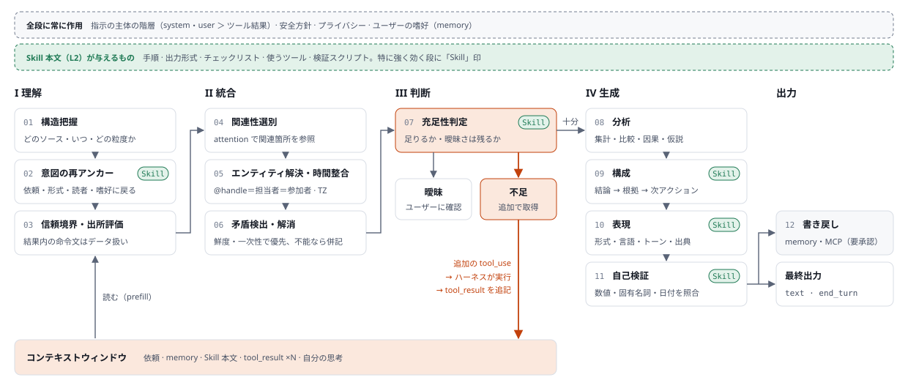

# 07. Claude 内部処理の解剖図 — Memory × Skills × 複数 MCP から出力まで

> 問い: Claude が memory・Skills・複数の MCP サーバから情報を得たあと、ユーザーが求めるアウトプットになるまでに、Claude の中では何が起きているのか。
> 本書はそれを **ハーネス（決定的なソフトウェア）** と **モデル（ステートレスな推論）** に分けて細分化し、アーキテクチャ図にする。
> Kagami の Agent Layer（[`02_architecture.md`](02_architecture.md) §3）を設計するための前提知識として置く。

---

## 0. 結論（4 点）

1. **境界**: 「Claude」は 2 つの系の合成である。memory・Skills・MCP を扱うのはモデルではなく **ハーネス**（Claude.ai / Claude Code / Agent SDK / 自前 Orchestrator）と、その配下のコード実行環境。モデルに届くのは **コンテキストウィンドウ上のトークン列だけ** で、モデルが外に出せるのも **トークン（thinking / text / tool_use）だけ**。
2. **状態**: モデルは **ステートレス**。ツールを 1 回呼ぶたびに API 呼び出しが 1 回増え、そのたびに全コンテキストを読み直す（先頭の共通部分はプロンプトキャッシュで再計算を省く）。「エージェントループ」はハーネスが回す while ループである。
3. **供給源**: Memory は **状態**（何を覚えているか）、Skills は **手順**（どうやるか）、MCP は **接続**（外部の現在値と操作）を供給する。三者とも「小さな索引を常駐させ、本体は必要なときに読む」という同じ段階的読み込みで動き、最後はトークンとしてモデルに届く。違いは、いつ・どれだけ・どの信頼度で入るか。
4. **処理**: 取得後の処理（理解 → 統合 → 判断 → 生成）は、モデル内部の **独立したモジュールではない**。1 つの Transformer の計算と、生成されるトークン列（思考ブロックを含む）の上に分散して現れる機能である。§5 の分解は機能モデルであり、実装上のパイプラインではない。Skills は、この機能の一部を「明文化した手順」と「決定的なスクリプト」に置き換える仕組みと見なせる。

### 記述の確度

| ラベル | 意味 |
| --- | --- |
| **[仕様]** | Claude API / MCP 仕様 / 公式ドキュメントに記載された挙動 |
| **[研究]** | Anthropic などの公開研究（解釈可能性、長文脈評価など）で観察された知見 |
| **[機能モデル]** | 観察できる入出力から組み立てた機能的な分解。内部実装についての主張ではない |

Claude.ai などの製品ハーネスの細部（プロンプトの構成、ツール結果の切り詰め閾値、メモリの注入方式など）は、製品とバージョンごとに異なり、非公開の部分を含む。Claude Code の Skills に関する記述は 2026 年 9 月時点の公式ドキュメントに基づく。

---

## 1. 全体アーキテクチャ

縦方向はおおむね **時間** に対応する。コンテキストウィンドウはラウンドごとに下へ伸びていく。



オレンジの経路がツール実行ループ（1 周ごとに API 呼び出しが 1 回増える）。緑の枠が Skill 由来の要素。破線の枠がモデルの境界。Memory tool と Skill の読み込み・スクリプト実行は MCP ではなく、ハーネス（またはコード実行環境）側のファイル操作として行われる。実際の順序（Skill を読んでから MCP を呼ぶ）は §3 の時系列図を参照。

### 構成要素の役割

| 層 | 構成要素 | 役割 | 確度 |
| --- | --- | --- | --- |
| 外部 | Memory | 会話をまたいで残る状態。起動時にコンテキストへ注入される（push: CLAUDE.md、メモリ要約など）か、ツール経由で必要時に引かれる（pull: Memory tool、過去会話検索）。**モデルの重みには保存されない** | [仕様] |
| 外部 | Skills | 手順と資料とスクリプトをまとめたディレクトリ（`SKILL.md` ＋ references・scripts・assets）。起動時に name と description だけが載り、本体は必要時に読まれる（§2） | [仕様] |
| 外部 | MCP サーバ | tools / resources / prompts を公開する別プロセスまたはリモートサービス。Slack・Notion・Drive などの実データへのアダプタ | [仕様] |
| ハーネス | コンテキスト組み立て | tools 定義（MCP の `tools/list` 由来、Skill tool や bash を含む）→ system（Skill 一覧を含む）→ messages の順に連結して API に送る。この順序がプロンプトキャッシュの単位にもなる | [仕様] |
| ハーネス | ツールルータ／権限ゲート | モデルが出した `tool_use`（ツール名＋JSON 引数）を検証し、自動許可・ユーザー承認・拒否を決めて実行する。独立な呼び出しは並列に実行する。Claude Code では Skill の `allowed-tools` がその Skill を使うターンの事前許可になる | [仕様] |
| ハーネス | ツール実行（ファイル・コード） | Memory tool、Skill の読み込み（Claude Code の Skill tool、API では code execution コンテナ内の bash）、Skill のスクリプト実行。スクリプトのコードはコンテキストに入らず、出力だけが返る | [仕様] |
| ハーネス | MCP クライアント | サーバごとに 1 対 1 で接続（stdio / Streamable HTTP 上の JSON-RPC 2.0）。`initialize` → `tools/list` → `tools/call` | [仕様] |
| ハーネス | コンテキスト管理 | プロンプトキャッシュ、会話の要約圧縮（compaction）、古いツール結果の消去（context editing）、大きな結果の切り詰め。Claude Code の compaction は、起動済み Skill の直近の内容を先頭 5,000 トークンまで（合計 25,000 トークンまで）要約の後ろに付け直す | [仕様]＋製品依存 |
| ハーネス | 出力レンダラ | `stop_reason = end_turn` の text を Markdown・表・図・ファイル・Artifact として表示・保存する | 製品依存 |
| 境界 | コンテキストウィンドウ | モデルが見る唯一の入力。tools 定義、system、Skill 一覧、memory、履歴、tool_use、tool_result、thinking がすべて 1 本のトークン列として並ぶ。Anthropic の Managed Agents のように、会話の完全な記録（セッションログ）をコンテキストの外に持ち、ハーネスがそこから必要な部分だけを載せる設計もある | [仕様] |
| モデル | Prefill / Decode | Prefill で追記分のトークンを一括で読み、Decode で 1 トークンずつ生成する。出力は thinking / text / tool_use のいずれかのブロック | [仕様]＋一般的な Transformer 推論 |

---

## 2. Skills の構造と段階的な読み込み

### 2.1 ディレクトリと SKILL.md

Skill は、ファイルシステム上のディレクトリである。必須なのは `SKILL.md` だけで、残りは任意。

```text
board-prep/
├── SKILL.md              # 必須。frontmatter（L1）＋ 本文（L2）
├── reference/
│   ├── template.md       # L3: 本文が指したときだけ読む
│   └── kpi-defs.md
├── scripts/
│   └── check_numbers.py  # L3: 実行するだけ。出力だけがコンテキストに入る
└── assets/
    └── memo-template.docx
```

```markdown
---
name: board-prep
description: 経営会議の準備メモを作る。Calendar・Notion・Slack から議題と論点を集め、結論先行・A4 1 枚にまとめる。「会議の準備」「アジェンダ」「論点整理」と言われたら使う。
---

# 経営会議の準備メモ

1. Calendar で会議の日時と参加者を確認する
2. Notion の議題ページと Slack の関連スレッドを集める
3. reference/template.md の骨格に沿って書く
4. 数値は scripts/check_numbers.py で検算してから載せる
```

- frontmatter の必須項目は `name`（64 文字以内、小文字・数字・ハイフンのみ、"anthropic" と "claude" は使えない）と `description`（1,024 文字以内）。[仕様]
- `description` は「何をするか」と「いつ使うか」の両方を書く。モデルは依頼を description と照らし合わせて起動を判断するので、description は **起動のルーティング規則そのもの** になる。[仕様]

### 2.2 段階的な読み込み（progressive disclosure）



| 段階 | いつ入るか | コストの目安 | 中身 | 確度 |
| --- | --- | --- | --- | --- |
| L1 メタデータ | 起動時から常に | 約 100 トークン／Skill | frontmatter の name と description。system prompt に載る | [仕様] |
| L2 本文 | 起動を判断したあと | 5k トークン未満を推奨 | SKILL.md の本文（手順・出力形式・チェックリスト） | [仕様] |
| L3 以降 | 必要になったとき | 読んだ分だけ | 参照ファイルは読んだときに入る。スクリプトは bash で実行され、**出力だけ** が入る | [仕様] |

同梱ファイルは読まれるまでコンテキストを消費しないので、Skill に含められる資料の量には実質的な上限がない。[仕様]

### 2.3 表示面ごとの違い

| 項目 | Claude API | claude.ai | Claude Code |
| --- | --- | --- | --- |
| 置き場所 | Skills API（`/v1/skills`）でアップロード。ワークスペースで共有 | 設定から zip でアップロード。ユーザー個人のみ | `~/.claude/skills/`（個人）、`.claude/skills/`（プロジェクト）、プラグイン、組織管理 |
| 事前構築 Skill | pptx・xlsx・docx・pdf | 文書作成時に自動で使われる | 文書系は非対応（Claude API skill は同梱） |
| 読み込み方 | code execution tool のコンテナ内で、モデルが bash で読む。`container.skills` で 1 リクエスト最大 20 個 | コード実行環境の中で読む | Skill tool が SKILL.md を描画し、1 つのメッセージとして会話に挿入する。以後のターンにも残る |
| 実行環境 | ネットワークなし、実行時のパッケージ追加不可 | 設定により全面・一部・なし | 手元の PC と同じ |
| 固有の仕組み | バージョン固定（`skver_…` / `latest`）、長時間処理は `pause_turn`、生成ファイルは Files API で取得 | ― | `allowed-tools`、`context: fork`（サブエージェントで実行）、`model`・`effort` の上書き、`disable-model-invocation`、`` !`command` `` による事前展開、`$ARGUMENTS` |

- Custom Skill は **表示面の間で同期されない**。claude.ai、API、Claude Code のそれぞれに別々に置く必要がある。[仕様]
- Claude Code では、description（＋ `when_to_use`）は一覧上で 1,536 文字に切り詰められる。`disable-model-invocation: true` にすると description はコンテキストに載らず、ユーザーが `/名前` で呼んだときだけ読み込まれる。[仕様]
- Claude Code の `` !`command` `` は、Skill の本文がモデルに届く **前に** ハーネスがシェルで実行し、出力で置き換える。モデルはコマンドではなく結果だけを見る。[仕様]
- `context: fork` の Skill は、本文がサブエージェントへの指示になり、会話履歴を持たない別コンテキストで実行される。親に戻るのは結果だけ。[仕様]

### 2.4 信頼の扱い

Skill の本文は、モデルが **手順として従う指示** になる。これはツール結果（中の命令文には従わない「データ」）とは逆の扱いで、だから公式ドキュメントは Skill を「ソフトウェアのインストールと同じように」扱い、信頼できる出所のものだけを使うよう求めている。悪意ある Skill はツールの不正な呼び出しや情報の持ち出しを指示できる。外部 URL から内容を取ってくる Skill は、取得した内容に悪意ある指示が混じる危険がある。[仕様]

### 2.5 Memory・Skills・MCP の比較

| 観点 | Memory | Skills | MCP |
| --- | --- | --- | --- |
| 供給するもの | 状態: ユーザーやプロジェクトについての事実と嗜好 | 手順: やり方・出力形式・チェックリスト・決定的なスクリプト | 接続: 外部システムの現在値と操作 |
| 実体 | ファイル（CLAUDE.md、`/memories`）や製品側のメモリ | ディレクトリ（SKILL.md ＋ references・scripts・assets） | 別プロセスまたはリモートのサーバ |
| 常駐するもの | CLAUDE.md・メモリ要約（製品による） | name と description（L1） | ツール定義（遅延ロードも可） |
| 必要時に入るもの | Memory tool・過去会話検索の結果 | SKILL.md 本文、参照ファイル、スクリプトの出力 | tool_result |
| 実行する主体 | ハーネス（ファイル操作） | ハーネスまたはコード実行環境（bash） | MCP クライアント → サーバ |
| モデルにとっての扱い | CLAUDE.md は指示。蓄積された事実は参考情報（古い可能性がある） | 導入者が信頼した手順として従う | データとして扱い、中の命令文には従わない |
| 主なリスク | 古くなった事実を現在の事実として扱う | 悪意ある Skill、description の書き方による起動漏れ・誤起動 | プロンプトインジェクション、大きすぎる結果 |

Skills と MCP は競合しない。MCP が「何に触れられるか」を与え、Skill が「それをどの順で、どの形式に仕上げるか」を与える。Anthropic は Skill を、外部ツールを使う複雑なワークフローを教えて MCP を補完するものと位置づけている。[仕様]

---

## 3. 1 ラウンドの流れと、エージェントループ

1. **接続時**: ハーネスが各 MCP サーバに接続し（`initialize` → `tools/list`）、ツール定義（名前・説明・入力 JSON Schema）を取得する。memory の一部（CLAUDE.md、メモリ要約など）と、各 Skill の name・description を読み込む。[仕様]
2. **組み立て**: ハーネスが tools → system → messages の順にコンテキストを組み、API に送る。[仕様]
3. **推論**: モデルは依頼を Skill の description と照らし合わせ、該当すれば Skill を起動する。取得が必要なら `tool_use` ブロックを出して止まる（`stop_reason = tool_use`）。互いに独立な取得は、1 ターンに複数の `tool_use` を並べて並列に要求できる。[仕様]
4. **実行**: ハーネスが `tool_use` を検証し、権限ポリシーを適用して、該当する MCP クライアント経由の `tools/call`、またはファイル読み込み・スクリプト実行を行う。[仕様]
5. **追記**: 結果を `tool_result` ブロック（`tool_use_id` で対応付け）として次の user ターンに追記する。extended thinking 使用時は、直前の assistant ターンの thinking ブロックも一緒に送り返す。大きすぎる結果の扱い（切り詰め・ページング・ファイル退避）はハーネス次第で、たとえば Claude Code はツール応答を既定で 25,000 トークンに制限している（2025 年の Anthropic の記事による）。[仕様]＋製品依存
6. **再推論**: 2 に戻る。モデルは追記分を含む全体を読み直し、足りなければ追加取得し、足りれば最終回答を出す（`stop_reason = end_turn`）。
7. **出力と書き戻し**: ハーネスがレンダリングする。書き込み系の操作（Notion ページ作成、Slack 投稿、memory 更新）も `tool_use` として出され、権限ゲートを通って実行される。

例: 「来週の経営会議の準備メモを作って」（memory: 結論先行・A4 1 枚が好み。Skill: §2.1 の `board-prep`）



この例では API 呼び出しが 5 回、モデルが全コンテキストを読む回数も 5 回になる。2 回目以降はキャッシュ済みの先頭部分を再計算しない。Skill の本文が、どの MCP をどの順で呼ぶか、何で検算するかを決めている点に注目したい。

---

## 4. モデルの計算として見ると（Prefill と Decode）

- **Prefill（読む）**: 新しく追記されたトークン（多くは tool_result や Skill の本文）をまとめて並列に処理し、各層の中間状態を作る。キャッシュ済みの先頭部分（tools・system・過去のターン）は再計算しない。「MCP の結果や Skill を読む」工程の実体はここにある。[仕様]（プロンプトキャッシュ）＋一般的な Transformer 推論
- **Decode（書く）**: 1 トークンずつ生成する。各トークンは全層の attention を通じて、memory・Skill の手順・すべての MCP 結果・自分の思考を参照できる。§5 の ①〜⑪ は、この自己回帰の過程に分散して現れる。
- **内部で起きていることについての研究知見**: Claude 3.5 Haiku を対象にした回路解析では、韻を踏む語を先に決めてから行を書くような先読みの計画や、「A の所在地 → その州 → 州都」のような多段の推論が内部表現として観察された。一方で、思考として書かれた説明が実際の計算経路と一致しない例も報告されている。思考ブロックは有用な作業領域だが、内部計算の完全な記録ではない。[研究]

---

## 5. 取得後〜出力までの機能分解（本題）

memory・Skill・MCP の結果がコンテキストに入ったあと、モデルが担う役割を 12 に分ける。番号は論理的な依存順を表す。実際には 1 回の生成の中で行き来し、思考ブロックの中で順序が入れ替わることも多い。緑の「Skill」印は、Skill の本文が特に強く効く段。



| # | 役割 | 何をしているか | Skill による補強 | 典型的な失敗 | 確度 |
| --- | --- | --- | --- | --- | --- |
| ① | 構造把握 | tool_result の JSON・テキスト・検索結果を読み、どのソースの、いつの、どの粒度のデータかを把握する。memory（過去の蓄積）と MCP の live データ（現在値）を区別する | スキーマや用語の定義を参照資料として渡せる | スキーマの誤読、ID と表示名の取り違え | [機能モデル] |
| ② | 意図の再アンカー | 長いツール結果を読んだあとで、依頼と制約（形式・言語・読者・分量）と memory 上の嗜好に立ち返り、「良い出力」の条件を確定し直す | 手順と出力形式が「良い出力」の定義を与える | 取得データに引っ張られて依頼から逸れる | [機能モデル] |
| ③ | 信頼境界・出所評価 | 指示を出す主体は system（オペレーター）と user。ツール結果や文書の中にある命令文は「情報」として扱う。出所・鮮度・一次性で重みを付ける | Skill の本文は従う対象の指示になる。導入元が信頼できることが前提 | プロンプトインジェクション、古い memory を現在の事実として扱う | [仕様]（安全ガイダンス）＋[機能モデル] |
| ④ | 関連性選別 | 生成する各トークンが attention でコンテキスト全体から関連箇所を参照する。結果が大きくノイズが多いほど、取りこぼしや希釈が起きやすい | 見るべき項目を手順で指定できる | 長文中盤の見落とし、ノイズへの過反応 | [研究]＋[機能モデル] |
| ⑤ | エンティティ解決・時間整合 | Slack の @handle、Notion の担当者、Calendar の参加者を同一人物として結び付ける。タイムゾーンをそろえ、「来週」を現在日付から解決し、重複を除く | 名寄せの規則を参照資料やスクリプトで渡せる | 同名別人の誤統合、タイムゾーンのずれ | [機能モデル] |
| ⑥ | 矛盾検出・解消 | ソース間の不一致を見つけ、新しさ・一次性・権威で優先を決める。決められなければ両論を併記する | どのソースを正とするかを明文化できる | 黙って片方を採用する、混ぜて存在しない事実を作る | [機能モデル] |
| ⑦ | 充足性判定 | 足りない → 追加の tool_use（ループ）。曖昧 → ユーザーに確認。十分 → 生成へ。この判断は、出力が tool_use か text かという形で外に現れる | チェックリストが「揃ったか」の基準になる | 早すぎる打ち切り、過剰な取得 | [仕様]（tool_use / end_turn）＋[機能モデル] |
| ⑧ | 分析 | 集計・比較・因果推論・仮説形成・優先順位付け。extended thinking（ツール呼び出しの合間に考える interleaved thinking を含む）で明示的な作業領域を持てる | 計算をスクリプトに移せば決定的になる | 算術・集計の誤り、根拠の飛躍 | [仕様]＋[機能モデル] |
| ⑨ | 構成 | 結論 → 根拠 → 次アクションの骨格を作り、読者の知識水準に合わせて抽象度を決める | テンプレートが骨格を与える | 情報の羅列で終わる（統合の不足） | [機能モデル] |
| ⑩ | 表現 | Markdown・表・コード・図・JSON などの形式、言語とトーン、出典表示。形式を厳密に守らせたい場合は Structured Outputs（JSON Schema による制約付きデコード）で API 側から保証できる | 形式の規則・assets の雛形・ファイル生成スクリプト | 形式違反、出典の欠落 | [仕様]＋[機能モデル] |
| ⑪ | 自己検証 | 数値・固有名詞・日付をソースと照らし合わせ、制約を満たしているか確かめ、不確実な点を明示する。独立した検証器があるわけではなく同じ生成過程の中で行うので、保証にはならない | 検証スクリプトで決定的に確かめられる | 検証したつもりの誤り | [機能モデル] |
| ⑫ | 書き戻し | memory の更新や、書き込み系 MCP ツール（ページ作成・投稿）の tool_use を出す。実行するかどうかはハーネスの権限ゲートが決める | Claude Code では `allowed-tools` で事前許可の範囲を宣言できる | 意図しない外部への作用 | [仕様] |

**全段に常に作用するもの**: 指示の主体の階層、安全方針、プライバシー、ユーザーの嗜好（memory）。これらは特定の段ではなく、すべての段の判断に効く。

---

## 6. コンテキスト予算（ハーネス設計が品質を決める理由）

複数の MCP を並列に呼ぶと、tool_result はすぐに数万トークンになり、コンテキストの最大の消費者になる。長いコンテキストでは中盤の情報が使われにくい傾向（Liu et al., 2023）や、トークン数の増加に伴う想起精度の低下（context rot）が報告されている。[研究] 品質は、モデルに何をどれだけ読ませるかでかなり決まる。

| 対策 | 何をするか | 確度 |
| --- | --- | --- |
| Skill の段階的読み込み | 手順や参照資料を system prompt に常駐させず、name と description だけを載せ、本体は必要時に読む | [仕様] |
| スクリプトへの委譲 | 決定的な処理を Skill のスクリプトにして、コードではなく出力だけをコンテキストに入れる | [仕様] |
| ツール定義の遅延ロード | ツール数が多いとき、定義を最初から全部載せず、ツール検索で必要なものだけ読み込む（`defer_loading`） | [仕様] |
| 結果の絞り込み | ページング、フィールド選択、要約して返す MCP ツール設計 | 設計次第 |
| 古い結果の消去・要約圧縮 | 使い終わった tool_result を消す（context editing）、会話を要約して置き換える（compaction） | [仕様] |
| サブエージェントへの委譲 | 取得と要約を別コンテキストの子エージェントに任せ、要点だけを親に返す（Claude Code の `context: fork` の Skill もこれにあたる） | [仕様] |
| コード実行側での処理 | Programmatic Tool Calling や「MCP をコードの API として呼ぶ」方式で、ツールの中間結果をコンテキストに入れず、集計結果だけを戻す | [仕様] |
| 配置 | 長い文書を前に、問いと指示を末尾に置く。公式ガイドのテストでは、複数文書の入力で応答品質が最大 30% 改善したと報告されている | [仕様] |

---

## 7. よくある誤解

| 誤解 | 実際 |
| --- | --- |
| memory はモデルの中に保存される | 重みは会話では更新されない。memory は外部のストアで、注入（push）またはツール（pull）でコンテキストに入って初めて効く |
| Skill はモデルを追加学習させる | Skill はファイルで、読まれてコンテキストに入ったときだけ効く。重みは変わらない |
| Skill を入れるほどコンテキストを圧迫する | 常駐するのは name と description（約 100 トークン／Skill）だけ。ただし description の書き方が悪いと起動漏れや誤起動が起きる |
| Skill のスクリプトはモデルが読んでから実行する | スクリプトは bash で実行され、コードはコンテキストに入らない。入るのは出力だけ |
| Skill と MCP は代替関係にある | MCP は接続、Skill は手順を供給する。Skill が MCP の呼び方を教える形で組み合わせるのが基本 |
| Claude が MCP サーバに直接つながっている | つながっているのはホストアプリ内の MCP クライアント。モデルは `tool_use` を JSON として出すだけで、実行はハーネスが行う |
| ツール実行中、モデルは待機して状態を保っている | 各ラウンドは独立した推論呼び出し。状態は再送されるコンテキストそのもので、プロンプトキャッシュで効率化されている |
| 内部に Planner や Verifier のモジュールがある | 機能の説明としては有用だが、実体は単一ネットワークの計算。検証は保証されないので、重要な数値はハーネス側か Skill のスクリプトで決定的に検証するのが定石 |
| 思考ブロックが内部計算のすべて | 思考テキストは計算の一部を言語化したもの。解釈可能性研究では、書かれた説明と実際の計算経路が一致しない例が報告されている |

---

## 8. Kagami（本プロジェクト）への設計示唆

1. **エンティティ解決と時間の正規化は ETL 側で決定的に行う**（[`02`](02_architecture.md) §1.2）。解決済みの ID と lineage をモデルに渡せば、⑤⑥ の確率的な処理が減り、誤統合の原因を取り除ける。
2. **MCP ツールは「要約＋構造化＋出典（source・timestamp・id）」で返す**。①③④ の負荷とコンテキスト消費を同時に減らし、⑩ の出典表示もしやすくなる。
3. **memory の役割を分ける**。嗜好・手続き（Procedural）は memory、現在の事実は live ソースを優先する、という規則を system prompt に明記する。③⑥ の判断基準をモデル任せにしない。
4. **数値はモデルに計算させない**。`gapScore` や `motivationState` は [`src/core/functions.ts`](../src/core/functions.ts) で算出して渡し、モデルには解釈と言語化を任せる。⑧⑪ の誤り源を構造的に消せる。
5. **伴走の儀式を Skill として定義する**。Morning Brief や Weekly Review（[`06`](06_motivation_engine.md)）の手順・出力形式・チェックリストを SKILL.md に、検算や集計をスクリプトにまとめる。Procedural Memory（[`02`](02_architecture.md) §2.2）の「どう励ますと動くか」を、Skill の参照資料として育てる形にもできる。
6. **Skill の description はルーティング規則として評価する**。どの依頼で起動し、どの依頼で起動しないかをテストケースにして、起動漏れと誤起動を測る。
7. **専門エージェントの分割はコンテキスト隔離として設計する**（[`02`](02_architecture.md) §3.1）。Librarian や Analyst の取得・要約を子コンテキスト（サブエージェントや `context: fork` の Skill）で行い、Coach には結論だけを渡す。
8. **書き戻し Action は権限ゲートで人間の承認を挟む**（[`02`](02_architecture.md) §3.4）。モデルの `tool_use` は提案に過ぎず、実行の可否はハーネスが決める。Skill の `allowed-tools` で事前許可する範囲は、読み取り系に限る。
9. **出力形式は Structured Outputs やスキーマで固定し、姿勢（Coach のトーン）はプロンプトや Skill で制御する**。形式の保証と表現の柔軟さを別の仕組みに担わせる。

---

## 参考（公開情報）

- Model Context Protocol Specification（modelcontextprotocol.io）: アーキテクチャ（host / client / server）、tools・resources・prompts、JSON-RPC 2.0、stdio / Streamable HTTP
- Anthropic, Claude API ドキュメント: Agent Skills（overview、Using Agent Skills with the API、best practices）、Tool use（並列ツール呼び出し、`tool_result`）、Extended thinking（interleaved thinking）、Prompt caching、Memory tool、Context editing、Tool search、Programmatic tool calling、Structured outputs、Long context prompting tips
- Anthropic, Claude Code ドキュメント: Skills（配置場所、frontmatter、Skill tool、`context: fork`、compaction 時の扱い）
- Anthropic, "Equipping agents for the real world with Agent Skills"（2025。同年 12 月に Agent Skills をオープン標準として公開）
- Anthropic, "Building effective agents"（2024）
- Anthropic, "Effective context engineering for AI agents"（2025）
- Anthropic, "Writing effective tools for AI agents—using AI agents"（2025）
- Anthropic, "Code execution with MCP: building more efficient AI agents"（2025）
- Anthropic, "Scaling Managed Agents: Decoupling the brain from the hands"（2026）
- Anthropic, "Tracing the thoughts of a large language model"（2025）
- Anthropic, "Reasoning models don't always say what they think"（2025）
- Liu et al., "Lost in the Middle: How Language Models Use Long Contexts"（TACL, 2024）
