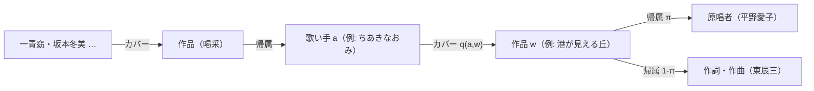
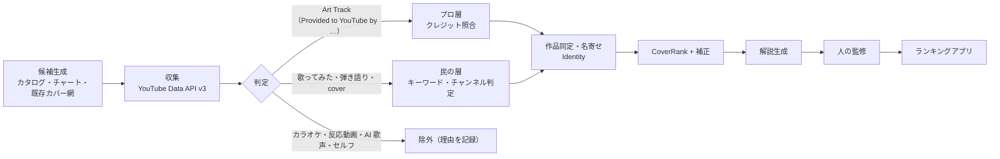

# 語り継ぎランキング・システム設計（Kataritsugi Rank）

> 「酒と泪と男と女」のような名曲を次の世代へ手渡すための、**本質ランキング・エンジン**の設計書。
> アプリ（UI）より先に、このランキングの定義と検証可能性を固める。実装は `src/`、PoC の結果は `out/RANKING.md`。

---

## 0. 要約

- **定義**: 語り継ぐべき名曲とは、*目の肥えた歌い手たちが、世代・ジャンル・国境を越えて「自分の声で歌い直すこと」を選び続けてきた曲* である。
- **中核となる洞察**: カバーは**コストの高い推薦**（costly signal）である。再生数・売上・いいねは安い信号で、宣伝と流行に汚染されやすい。カバーは歌い手が自分の名前・アルバムの枠・ステージの時間を賭ける行為であり、しかも「誰が歌い直したか」で重み付けできる。学術論文の**引用**に相当する。
- **アルゴリズム**: 歌い手×作品の二部グラフ上の PageRank（**CoverRank**）に、`世代到達 × 越境 × 持続` の 3 つの補正を掛ける。
- **説明**: 「データの証言」（グラフから決定的に生成されるので捏造の余地がない）と、「文脈の解説」（監修済みノート、または証言だけを根拠にした LLM 生成）の二層で書く。
- **検証**: 正解ラベルはない。主指標は**時間分割バックテスト**とする。2015 年までのグラフで、2016〜2025 年に新しい世代が歌い直す曲を予測できるかを測る。「語り継がれる」をいちばん直接に測る検証になる。

```
語り継ぎスコア(w) = CoverRank(w) × 世代到達(w) × 越境(w) × 持続(w)
                     ─────┬─────   ────┬────   ───┬───   ───┬───
                    誰が歌い継いだか  何世代に   どの畑・国に  一過性でないか
                    （質で重み付け）  渡ったか   渡ったか
```

---

## 1. 「本質的な価値」を観測できる量に落とす

曲の良し悪しそのものは主観である。一方、**語り継がれる**ことは観測できる現象で、それは世代を越えた再演として現れる。そこで本システムは「良い曲か」を直接は問わず、**良い曲に起きる行動の痕跡**を測る。

| 観測する性質 | 問い | 対応する項 |
| --- | --- | --- |
| 伝承の質 | 誰が歌い継いだか（その人自身も一流か） | CoverRank |
| 時間の深さ | 何世代に手渡されたか | 世代到達 |
| 文化の幅 | 演歌からロック、海外まで畑を越えたか | 越境 |
| 持続 | 一時の流行（単発バズ）ではないか | 持続 |

**カバーを使う理由（cheap signal と costly signal の違い）**

- 再生数・チャートは「聴かれた量」であって「価値」ではない。宣伝予算・タイアップ・アルゴリズムの推薦がそのまま混ざり、時間とともに忘れられる曲も高く出る。
- カバーは**供給側の専門家による評価**である。プロの歌い手は限られた枠に入れる曲を選ぶ。その選択には「この曲は自分が歌う価値がある」という判断が含まれる。
- 推薦が推薦を呼ぶ構造（引用ネットワーク）なので、PageRank の理論がそのまま使える。

**測らないもの（明示的な限界）**

- 歌詞の文学性やメロディの美しさを直接は測らない。測るのは、それらの結果として起きた伝承行動である。
- カバーされやすさは**歌いやすさ・カラオケ映え・権利処理・テレビ企画**にも左右される。これは §6 で個別に対策する。

---

## 2. データモデル



- **作品（Work）単位**で同定する。録音単位ではない。本番では ISWC / JASRAC 作品コード / MusicBrainz Work ID をキーにする。訳詞・翻案は**系譜（lineage）**として同じ作品に紐付ける（例: 「上を向いて歩こう」→ “Sukiyaki”）。
- **歌い手（Artist）**は、同じ創作主体（本人・在籍バンド・別名義）を `Identity` で束ねる（`seed/identities.json`）。これによって「桑田佳祐がサザンの曲を歌う」「玉置浩二が安全地帯の曲を歌う」を**セルフカバーとして除外**できる。
- **カバー辺**には必ず**証拠 URL**を持たせる。証拠のない辺はグラフに入れない。
- **除外**するもの: セルフカバー、AI 歌声、カラオケ・インスト、反応動画・歌詞動画、メドレー。

---

## 3. CoverRank（中核アルゴリズム）

### 3.1 直観: ランダムサーファーの物語

> ある歌い手のカバーを聴く → 「この原曲は誰の曲だろう」と原唱者・作家を聴きに行く → その人が歌い直した別の曲へ … を延々と繰り返す。ときどき（確率 1−d で）まったく別の歌い手に飛ぶ。

このとき**作品を通過する頻度**が CoverRank である。多くの歌い手に歌い直された曲ほど通過頻度は高い。さらに、*自分の曲が他人に歌い継がれている歌い手*（＝歌い手の歌い手）が歌い直した曲ほど高くなる。

### 3.2 定式化

歌い手（作り手を含む）の権威を R、作品の CoverRank を S とする。

$$
S(w) = d \sum_{a \to w} R(a)\,\frac{q(a,w)}{\max\!\left(\sum_{v} q(a,v),\ k\right)^{\lambda}}
$$

$$
R(o) = (1-d)\,p(o) + d\,D\,p(o) + U\,p(o) + \sum_{w} S(w)\,\mathrm{share}(o,w)
$$

- $q(a,w)$: カバー辺の重み。商業リリースと PoC の証拠は 1。YouTube の一般投稿は $\min(1,\;0.2 + \log_{10}(1+\mathrm{views})/7.5)$ とし、再生数が効きすぎないよう頭打ちにする。
- $\mathrm{share}(o,w)$: 作品の権威を作り手へ戻す割合。原唱者に π、作詞・作曲者に 1−π を配る。同じ主体はまとめるので、シンガーソングライターは全量を受け取る。
- $p$: テレポート事前分布。**票を持つ歌い手（1 曲以上カバーしている人）にだけ**、種別の重みで配る。
- $D$: カバーを持たない人（作り手のみ）の質量。p に従って再配分する（dangling 処理）。
- $k$: 票の分母の下限（既定 3）。候補曲プールは歌い手の全レパートリーの一部しか見ていない。分母を観測数のままにすると、プール内で 1 曲しか観測されない歌い手がその曲に 1 票を丸ごと注いでしまう。そこで分母を「観測数」と k の大きい方にし、使われなかった分 $U$ は「観測されていないカバー先」とみなして p に従って再配分する（質量は保存される）。
- λ=1 のとき行確率行列になり、$\sum R = 1$ が保たれる。これが純 PageRank で、既定値である。

実装は `src/coverrank.ts` のべき乗法で、L1 差が 1e−12 未満になったら収束とみなす。PoC のデータ（約 1,000 辺）では 20 回あまりの反復で収束する。

### 3.3 設計判断とその理由

| 判断 | 理由 | 代替案と、採らなかった理由 |
| --- | --- | --- |
| 二部グラフにし、作品スコアを「流量」で定義する | 作品と歌い手の権威を分離できる。作家ランキングやジャンル別ランキングにも転用できる | 歌い手→歌い手のグラフに潰すと、作品単位の説明（誰の票か）が失われる |
| 票を out-degree で割る（λ=1） | **選択性**を評価するため。何でもカバーする企画歌手やカラオケ業者の 1 票は自然に薄まる | λ=0（割らない）は多作な人が支配する。λ は感度分析で 0.5 も検証する |
| 分母に下限 k=3 を置く | 抜き取り調査では、たまたま 1 曲しか観測されなかった歌い手の票が過大になる。PoC で実際に起きた（「残酷な天使のテーゼ」で権威の高い高橋洋子が、プール内では「ひこうき雲」1 曲だけをカバーしていたため、カバー 2 件の同曲が 27 位まで上がった） | k=1 は純 PageRank。網羅的なデータでは k の影響は小さくなる。感度分析で 1・3・5 を検証する |
| 原唱者と作家に π で配分する | 歌い手の権威の源泉を「歌唱」と「作品」の両方に置く。作家だけの人（筒美京平・阿久悠など）は票を持たないが権威を受け取る | 原唱者だけに戻すと、提供曲の多い作家の功績が消える |
| 事前分布 p に人気（登録者数・売上）を入れない | 人気が人気を呼ぶ自己強化を避けるため。人気は「歌い直された」という形でのみ効かせる | 入れる場合は log で頭打ちにし、一様分布と混合する |
| 種別の重みを pro=1, foreign=1, net=0.5, choir=0.3, amateur=0.05 とする | 「プロの声」と「民の声」の比率を決める**唯一のつまみ**。一般投稿は 1 本あたりは軽いが、数が集まれば効く | 民の層を別スコアにして最後に混ぜる案もある（§9） |

**PoC で観測できた「歌い手の歌い手」効果**: 「喝采」が 14 組に歌い継がれているため、ちあきなおみの権威は最小の歌い手の 13.7 倍になった。そのちあきなおみが歌い直した「港が見える丘」は、カバー数 7 で全体 5 位に上がる。同様に、玉置浩二（安全地帯）による「時代おくれ」のカバーは、無名の歌い手の数票分に相当する。

---

## 4. 語り継ぎ補正

### 4.1 世代到達

$$
\text{世代到達}(w) = 1 + \alpha \cdot \min\!\left(1,\ \frac{\#\{\text{原曲の年代より後にデビューした歌い手の年代}\}}{\text{genCap}}\right)
$$

- 「語り継ぐ」の字義は**次の世代への手渡し**である。だから人数ではなく、**何世代（デビュー年代）に手渡されたか**を数える。
- 原曲と同じ年代、あるいは先輩世代のカバーは、ここでは数えない（CoverRank には入る）。
- 既定値は α=0.5、genCap=4（4 世代で満点）。最大で ×1.5 になる。

### 4.2 越境

$$
\text{越境}(w) = 1 + \beta \cdot \min\!\left(1,\ \frac{\exp(H) - 1}{3}\right),\quad H = -\sum_k p_k \log p_k
$$

- $p_k$ は、カバーした歌い手の**畑**（歌謡・演歌／フォーク・NM／ポップス／ロック／ジャズ・声楽／アニソン／沖縄／ネット／海外）の分布である。原曲の畑も 1 票として入れるので、「演歌の曲を全員ロック勢が歌った」場合も越境として測れる。
- カテゴリは意図的に粗くしてある。細かいラベルで多様性が水増しされるのを防ぐためである。
- 既定値は β=0.3。最大で ×1.3 になる。

### 4.3 持続（単発バズ補正）

- カバーの公開年が 5 件以上分かっている作品について、**任意の 2 年窓に入るカバーの最大割合** c を求める。c > 0.5 なら線形に減点し、c = 1 のとき ×0.6 になる（`burstFloor`）。
- 想定しているのは、SNS 起点で 1 年だけ「歌ってみた」が集中する曲である。それ自体は悪いことではないが、まだ「語り継がれた」とは言えない。
- 公開年の分からない証拠（PoC の Web 検索証拠）には**適用しない**。推測で減点しない。

### 4.4 合成を乗法にする理由

- CoverRank が主役で、補正は最大でも ×1.5・×1.3・×0.6 の幅に収める。
- 加法ではなく乗法にするのは、**伝承の証拠がない曲を補正だけで押し上げない**ためである（CoverRank=0 なら 0 のまま）。

### 4.5 時代の公平性

古い曲は歌い継がれる時間が長いので、構造的に有利になる。これは「語り継がれてきた」を測る以上は正しい性質である。ただし「**これから語り継ぐべき**新しい曲」を見逃す。そこで、メインランキング（実証済みの伝承）とは別に「**未来の名曲候補**」枠を設ける。同じ発表年代のコホートの中で CoverRank を標準化して並べる方式で、Mariani, Medo & Zhang (2016) の rescaled PageRank と同じ考え方である。実装は `cohortZ`（`src/legacy.ts`）で、発表年が ±5 年の曲どうしで log(スコア) の z 値を取る。レポートでは 2000 年以降に発表された曲をこの z 値で並べる。

---

## 5. YouTube データパイプライン



### 5.1 二つの層

| 層 | YouTube 上の実体 | 判定方法 | 意味 |
| --- | --- | --- | --- |
| **プロ層** | Topic チャンネルの **Art Track**（自動生成された商業音源。説明欄に `Composer:` / `Lyricist:` / `Released on:` が構造化されて載る） | 説明欄を構文解析し、**作家クレジットが一致するものだけ**を採る。同名異曲はここで確実に弾ける | 他の歌い手が商業リリースした録音＝プロによる推薦票 |
| **民の層** | 「歌ってみた」「弾き語り」「cover」の一般投稿 | タイトルのキーワード、チャンネル名、登録者数で判定する。カラオケ・インスト・反応動画・メドレー・AI 歌声は除外する | 世の中で実際に歌われ続けているか |

Art Track は「**曲名 + 作曲者名**」で検索すると引っかかる。説明欄にクレジットが入っているので、検索インデックスに作家名が含まれるためである。これが、YouTube だけでプロの伝承網を再構成するための鍵になる（`src/ingest/youtube.ts` の `queriesFor`）。

### 5.2 作品同定の落とし穴

- **同名異曲**: 「糸」「駅」「花」「時代」「Lemon」など。Art Track はクレジット照合で弾く。一般投稿では、2 文字以下の曲名なら原唱者名か作家名の併記を必須にする（`classify.ts`）。
- **翻案・訳詞**: 「北国の春」の中国語版、「上を向いて歩こう」の英語版。作品の系譜表で同じ作品に寄せ、越境の証拠として数える。
- **セルフカバーと提供曲**: 作家本人の再録（例: 竹内まりやの「駅」）は除外する。同じ主体の判定には Identity を使う。
- **ライブ・TV 出演**: 番組（例: NHK「The Covers」）の選曲は番組の意思でもある。番組をノードにして票を分割する（§6）。

### 5.3 クォータとコスト

`search.list` は 1 ページ 100 units、`videos.list` と `channels.list` は 50 件ごとに 1 unit。既定のクォータは 10,000 units/日である。1 曲あたり 3〜4 クエリなので約 300〜400 units かかり、既定クォータでは **1 日 25〜33 曲**しか処理できない（`npm run quota`）。

→ 本番では、**プロ層をカタログ系データで作り**、YouTube は検証と民の層に絞るのが現実的である。カタログ系の候補は、MusicBrainz（CC0）、JASRAC 作品データベース J-WID、SecondHandSongs、配信サービスのクレジットなど。あわせて YouTube のクォータ拡張を申請する。

### 5.4 規約

- スクレイピングはしない（利用規約違反）。必ず公式 API を使う。
- YouTube API Services の Developer Policies に従い、取得データの保存期間と定期更新、表示時の帰属を設計に組み込む。

### 5.5 音声による確認（次段）

タイトルに曲名がないカバーや、タイトルを偽ったアップロードには、**カバー曲同定（Cover Song Identification）**モデルで対応する。代表例は ByteCover（Du et al., 2021）や CoverHunter（2023）で、評価には Da-TACOS や SHS100K を使う。原曲の音声とのクロマ・埋め込み類似度で確認し、AI 歌声の検出もこの段で行う。

---

## 6. バイアスと不正への対策

| リスク | 具体例 | 対策 | 状態 |
| --- | --- | --- | --- |
| 人気の自己強化 | 再生数の多い曲がさらに推薦される | 再生数はスコアに直接入れない（一般投稿の辺の重みとしてのみ、log で頭打ち） | 実装済み |
| 企画盤・トリビュート | レーベル主導で一斉にカバーされる | 同じアルバム・同じ番組から出た辺を束ねて 1 票にする | 設計済み |
| カラオケ・BGM 業者 | 大量のアップロード | 種別判定で除外し、残りは out-degree 正規化で希釈する | 実装済み |
| AI 歌声カバー | 2023 年以降に急増 | キーワードで除外。次段で音声判定を入れる | 実装済み（キーワード） |
| セルフカバー・別名義 | 本人・在籍バンド・作家の再録 | Identity によるセルフ判定 | 実装済み |
| 同名異曲 | 「糸」「駅」 | クレジット照合。短い曲名は作者名の併記を必須にする | 実装済み |
| 時代バイアス | YouTube 以前のカバーが見えない／古い曲ほど時間がある | 商業カタログで補完する。「未来の名曲候補」枠を別に出す | 枠は実装済み・補完は未着手 |
| 言語・市場バイアス | 英語圏の曲が圧倒する | 市場ごとにグラフを分ける（本 PoC は日本で発表された作品に限定）。国境越えは越境補正で加点する | 実装済み |
| 収集の抜け | 検索による抜き取り調査 | 未調査を 0 扱いしない（対象外にする）。証拠の欠損に対する順位区間を併記する | 実装済み |

---

## 7. 検証: 正解のない問題をどう検証するか

1. **予測妥当性（主指標）— 時間分割バックテスト**
   T=2015 年までのカバー辺だけでスコアを計算し、2016〜2025 年に**新しくデビューした世代**が歌い直した数を予測できるかを Spearman ρ と NDCG@50 で測る。比較対象は、素朴なカバー数、原曲の再生数、チャート最高位とする。「語り継がれる」を最も直接に検証する方法で、ここで負けるなら設計を見直す。
2. **専門家判断との整合**: 音楽評論家・研究者に一対比較をしてもらい、Bradley–Terry モデルで参照順位を作る。その順位と Kendall τ で比べる。
3. **外部カノンとの部分一致**: 文化庁の「日本の歌百選」などを**弱いラベル**として使い、再現率を見る。カノン自体にも偏りがあるので、一致率を目的関数にはしない。
4. **頑健性（実装済み）**: パラメータ格子（d × π × λ × α × β = 162 通り）と、証拠を 30% 間引くブートストラップ（300 回）で、各曲の順位の 10〜90 パーセンタイル区間を出す。
5. **アブレーション（実装済み）**: 素朴なカバー数順位との Kendall τ と、PageRank 化で大きく動いた曲を出力する。あわせて、検索要約が根拠の辺を除き、結果タイトルで直接裏付けられた辺だけで再計算したときの順位の保存度（上位の重なりと τ）も出力する。

---

## 8. 「なぜ語り継ぐべきか」の解説

- **データの証言**（`src/explain.ts`）: グラフから決定的に生成する。何組が歌い直したか、票の重い歌い手は誰か（その人が「歌い手の歌い手」かどうか）、何世代に手渡されたか、どの畑や国に渡ったか、単発バズかどうか、を書く。
- **文脈の解説**: 作品の文化的・音楽的な意味を書く層。監修済みのノート（`seed/notes.json`）を優先する。無い場合は LLM に、**証言に無い固有名詞・数字・逸話を書かない**という制約付きで書かせる。次段では、出力された固有名詞を証拠集合と突き合わせる検査器を入れる。
- **アプリでの体験**: 順位そのものより、「**語り継ぎの系譜図**」に価値がある。年代軸にカバーを並べ、「喝采」なら、ちあきなおみの原唱から一青窈・坂本冬美・宮本浩次の歌い直しまでを聴き比べられるようにする。ランキングは入口で、目的は聴き継がせることにある。

---

## 9. PoC の現状と次の一手

- 候補は 223 曲（1927〜2023 年に発表された邦楽）。収集手順を最後まで終えたのは **204 曲**で、ランキングの対象にしているのはこの 204 曲。カバー辺は約 1,000 件あり、そのうち出典 URL のある 994 件をグラフに入れている。手順の途中で止まった曲が 4 曲、未調査が 15 曲あり、どちらも対象外にしている（0 件と誤認しないため。また、調査量の差を順位に混ぜないため）。収集の手順と採否の基準は [`02_data_collection.md`](02_data_collection.md) に記録している。
- 証拠は**抜き取り調査**であって、網羅的なカバー一覧ではない。そのため `out/RANKING.md` は**暫定**の途中経過であり、順位には証拠欠損に対する区間を併記している。
- 歌い手のデビュー年代とジャンル（`seed/artists.json`）は、一般に知られた経歴に基づく**年代粒度の推定**である。不明なものは空欄のまま残している。本番では MusicBrainz の begin date や Wikidata の活動開始（P2031）に置き換える。

**次の一手**

1. 残り 19 曲（途中 4・未調査 15）の証拠収集を終え、確定版の Top 50 と解説を出す。
2. `YOUTUBE_API_KEY` を設定し、YouTube の二層（Art Track・一般投稿）を収集する（`npm run youtube`）。この環境から googleapis.com への到達は確認済み。
3. 網羅性を上げる。MusicBrainz（CC0）などのカタログ API を使うには、環境のネットワーク許可が必要になる。
4. 拡張: 作家ランキング（筒美京平・阿久悠・松本隆…）、Personalized PageRank によるジャンル別・世代別ランキング、「再評価枠」（権威あるカバーが多いのに大衆的には知られていない曲）。

---

## 参考文献

- Brin, S. & Page, L. (1998). The anatomy of a large-scale hypertextual Web search engine.
- Haveliwala, T. (2002). Topic-sensitive PageRank. WWW.
- Deng, H., Lyu, M. R. & King, I. (2009). A generalized Co-HITS algorithm and its application to bipartite graphs. KDD.
- He, X., Gao, M., Kan, M.-Y. & Wang, D. (2017). BiRank: Towards ranking on bipartite graphs. IEEE TKDE.
- Walker, D., Xie, H., Yan, K.-K. & Maslov, S. (2007). Ranking scientific publications using a model of network traffic. J. Stat. Mech.
- Mariani, M. S., Medo, M. & Zhang, Y.-C. (2016). Identification of milestone papers through time-balanced network centrality. J. Informetrics.
- Bryan, N. J. & Wang, G. (2011). Musical influence network analysis and rank of sample-based music. ISMIR.
- Spence, M. (1973). Job market signaling. QJE. ／ Zahavi, A. (1975). Mate selection — a selection for a handicap.
- Du, X. et al. (2021). ByteCover: Cover song identification via multi-loss training. ICASSP.
- Yesiler, F. et al. (2019). Da-TACOS: A dataset for cover song identification and understanding. ISMIR.
